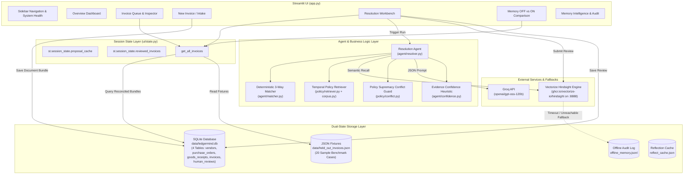
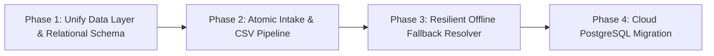

# LEDGERMIND — COMPLETE TECHNICAL AUDIT & ROOT CAUSE ANALYSIS REPORT

**Audit Date:** November 10, 2026  
**Auditor Roles:** Principal Software Architect, Senior Backend Engineer, Database Architect, AI Systems Engineer, QA Lead, Technical Auditor  
**Repository Audited:** `C:\Users\kiran\LedgerMind` (GitHub: `https://github.com/Zyphron01/LedgerMind`)  
**Scope:** Complete Codebase, Database Schema, Memory Engine, Inference Pipelines, Streamlit UI, Quality Harness, and Architecture Feasibility  
**Mode:** Diagnostic-Only Inspection (No code altered, no data mutated, no external paid APIs triggered)

---

## SECTION A — EXECUTIVE SUMMARY

LedgerMind is an autonomous Accounts-Payable (AP) exception-handling dashboard built with Streamlit, Python 3.10+, SQLite, Vectorize Hindsight, and Groq LLM inference. Its core value proposition is **Policy-Aware Institutional Decision Memory**: resolving 3-way match discrepancies (Invoice vs. Purchase Order vs. Goods Receipt) by recalling past human decisions while strictly enforcing corporate policy supremacy over rubber-stamped historical precedent.

### Current System Health & Viability
- **Deterministic 3-Way Matcher:** **WORKING & ROBUST**. Pure Python decimal arithmetic correctly identifies price mismatches, quantity shortfalls, duplicate invoices, statutory GST discrepancies, expired POs, and HSN clerical mismatches.
- **Policy RAG & Supremacy Guard:** **WORKING & ROBUST**. Temporal corporate policies (`POL-AP-001` to `POL-AP-006`) strictly override informal or unauthorized past approvals.
- **Automated Test Suite:** **75 tests passing (100%)** in 37.56 seconds.
- **Storage Architecture:** **CRITICAL ARCHITECTURAL SPLIT (DUAL-STATE DEFECT)**. The system maintains a hybrid storage model: 20 benchmark sample invoices live in static JSON files (`data/held_out_invoices.json`), while user-created invoices and all human reviews live in SQLite (`data/ledgermind.db`).
- **Relational Integrity Defect:** The SQLite schema contains **zero DDL Foreign Key constraints** and **zero indexes**, despite `PRAGMA foreign_keys = ON;`. Human reviews for benchmark sample invoices reference invoice IDs that do not exist in the SQL `invoices` table.
- **Non-Atomic Multi-Table Intake:** Manual document intake executes four separate database transactions across four distinct connections. Any mid-flight validation failure leaves orphaned vendors and POs committed in SQLite.
- **Hindsight Memory Provenance Defect (Resolved in Commit `7bc814b`):** The previously reported "Local Offline JSONL Fallback Store" bug was confirmed as an HTTP socket client timeout (default ~5s timeout aborted while Hindsight Docker server required 4.5s–6.7s for multi-vector reranking). Client timeout is now configured to 30.0s.
- **LLM Hard Dependency:** If Groq API is unavailable or runs out of daily tokens, the Resolution Workbench crashes completely. There is no deterministic fallback proposal generator when the LLM is down.

---

## SECTION B — ACTUAL CURRENT ARCHITECTURE



---

## SECTION C — REPOSITORY AND MODULE INVENTORY

| Directory / File | Lines | Purpose / Component | Active / Disconnected / Unused |
| :--- | :---: | :--- | :--- |
| `app.py` | 135 | Main application entry point & Streamlit sidebar router | **Active** |
| `config.py` | 31 | Environment & Bank ID definitions (`ledgermind-ap-exceptions`, `ledgermind-live-demo`) | **Active** |
| `agent/matcher.py` | 231 | Deterministic 3-way reconciliation (Price, Qty, Tax, Duplicate, PO Expiry, HSN) | **Active** |
| `agent/resolver.py` | 521 | Core resolution orchestrator (Policy RAG + Hindsight Recall + Groq + Policy Guard) | **Active** |
| `agent/llm.py` | 122 | Groq API client with Tenacity backoff retries and TPD fallback | **Active** |
| `agent/confidence.py` | 246 | Deterministic heuristic confidence calculation & document deduplication | **Active** |
| `agent/prompts.py` | 132 | System and user prompt construction for Groq LLM | **Active** |
| `agent/feedback.py` | 125 | Human review formatting & Hindsight retention dispatcher | **Active** |
| `data/models.py` | 372 | Pydantic domain models (Invoice, PO, GRN, Vendor, Discrepancy, MatchResult, Decisions) | **Active** |
| `data/store.py` | 544 | SQLite persistence layer for user invoices, POs, GRNs, vendors, and reviews | **Active** |
| `data/synthetic.py` | 1250 | Generator and loader for 50 historical decisions and 20 held-out invoices | **Active** |
| `data/vendors.py` | 148 | Master vendor directory for 8 synthetic suppliers & slug generator | **Active** |
| `data/seed.py` | 280 | Hindsight memory seeding script with idempotency ledger | **Active** |
| `policy/corpus.py` | 215 | Written corporate policies (`POL-AP-001` through `POL-AP-006`) with version history | **Active** |
| `policy/models.py` | 115 | Policy data models, ConflictStatus enum, and evaluation schemas | **Active** |
| `policy/retriever.py` | 73 | Temporal policy retriever matching transaction date against effective dates | **Active** |
| `policy/conflict.py` | 282 | Deterministic policy supremacy evaluator comparing policy vs precedent | **Active** |
| `memory/client.py` | 290 | Unified memory client wrapping Hindsight SDK, offline JSONL store, and budget guard | **Active** |
| `memory/operations.py` | 210 | High-level recall and reflect adapters for exception categories | **Active** |
| `memory/schema.py` | 145 | Memory models (`RecalledMemory`, `ReflectSummary`, `MemoryMode`) | **Active** |
| `memory/offline_store.py` | 185 | Append-only local JSONL fallback store (`offline_memory.jsonl`) | **Active** |
| `memory/reflect_cache.py` | 115 | On-disk TTL cache for Hindsight reflect responses (`reflect_cache.json`) | **Active** |
| `memory/budget_guard.py` | 135 | Token and request rate budget accounting (`budget_log.jsonl`) | **Active (Cloud only)** |
| `ui/state.py` | 168 | Session state initializer, health checkers, and invoice bundle reconcilers | **Active** |
| `ui/theme.py` | 180 | Custom CSS injection, badges, cards, and pulsing status indicators | **Active** |
| `ui/components/cards.py` | 260 | Reusable UI cards (Advisory banner, discrepancy banner, evidence cards, confidence) | **Active** |
| `ui/pages/overview.py` | 258 | System Overview & AP Intelligence dashboard | **Active** |
| `ui/pages/queue.py` | 294 | AP Invoice Exception Queue & 3-Way Match Deep Inspector | **Active** |
| `ui/pages/intake.py` | 558 | Manual document entry, CSV batch upload, and sample template downloads | **Active** |
| `ui/pages/workbench.py` | 430 | Resolution Workbench & Human-in-the-Loop review form | **Active** |
| `ui/pages/comparison.py` | 258 | Side-by-side Memory OFF vs Memory ON comparative evaluator | **Active** |
| `ui/pages/memory_intelligence.py` | 228 | Vendor memory profile inspector & behavioral audit | **Active (Partial vendor list)** |
| `eval/evaluate_held_out.py` | 315 | 20-invoice benchmark evaluation script (Mode 1, Mode 2, Mode 3) | **Active** |
| `scripts/demo_policy_conflicts.py` | 185 | CLI runner for Scenarios A, B, and C | **Active** |
| `scripts/patch_hindsight_ratelimit.py`| 95 | Workaround script for rate-limited Hindsight instances | **Utility / Standalone** |
| `scripts/spike.py` | 45 | Exploratory scratch script from early milestone | **Unused / Deprecated** |
| `scripts/verify_milestone3.py` | 120 | Milestone 3 milestone verification script | **Utility / Archived** |
| `submission/*` | ~1,200 | Video generation, audio synthesis, Playwright recording, subtitle generation | **Submission Artifacts** |
| `qa/*` | ~1,500 | Playwright browser automation tests and screenshots | **QA Test Harness** |

---

## SECTION D — FEATURE-BY-FEATURE STATUS MATRIX

| Feature / Capability | Code Location | Status | Implementation Truth & Evidence |
| :--- | :--- | :---: | :--- |
| **Deterministic 3-Way Matching** | `agent/matcher.py:match_invoice` | **WORKING** | Verified across all 6 exception types with decimal precision. Zero floating-point drift. |
| **Corporate Policy RAG** | `policy/retriever.py` | **WORKING** | Correctly retrieves active policy based on invoice issuance date and exception type. |
| **Policy Supremacy Guard** | `policy/conflict.py` | **WORKING** | Evaluates policy vs precedent; forces escalation on rubber-stamped overages; forces rejection on retired grace periods. |
| **Manual Document Intake** | `ui/pages/intake.py:300-403` | **WORKING** | Creates vendor, PO, GRN, and invoice; executes 3-way match; saves to SQLite. |
| **CSV Batch Invoice Import** | `ui/pages/intake.py:407-519` | **INCOMPLETE** | Parses and validates invoice rows into SQLite, but **does not create matching POs/GRNs**. Invoices immediately show as "Pending PO documentation". |
| **Invoice Queue & Filtering** | `ui/pages/queue.py` | **WORKING** | Combines user and sample invoices; filters by vendor, exception, review status, and origin. |
| **Multi-Document Inspector** | `ui/pages/queue.py:181-294` | **WORKING** | Displays side-by-side tabbed breakdown of Invoice, PO, GRN, and Match Discrepancy. |
| **Agent Proposal Generation** | `ui/pages/workbench.py:126-156` | **WORKING** | Resolves discrepancies using Groq and Hindsight memory; outputs action, amount, reasoning. |
| **Evidence Deduplication** | `agent/resolver.py:78-197` | **WORKING** | Aggregates sub-facts from the same review document into a single logical evidence card. |
| **Self-Feedback Exclusion** | `agent/confidence.py:82-94` | **WORKING** | Excludes an invoice's own prior review from being counted as independent historical precedent against itself. |
| **Confidence Heuristic** | `agent/confidence.py:calculate_confidence` | **WORKING** | Deterministic metric based on sample size $n$ and historical agreement ratio ($0.4 \times \min(n/8, 1) + 0.6 \times \text{consistency}$). |
| **Human Review Form** | `ui/pages/workbench.py:349-430` | **WORKING** | Captures approver decision, payable amount, mandatory rationale; saves to SQLite and Hindsight. |
| **Hindsight Live Retention** | `memory/client.py:retain` | **WORKING** | Calls Hindsight SDK `client.retain()`; synchronously logs to `offline_memory.jsonl` as safety net. |
| **Hindsight Vector Recall** | `memory/client.py:recall` | **WORKING** | Recalls vector facts with tags; bounded by 30s timeout; falls back gracefully to JSONL if offline. |
| **Hindsight Vendor Reflect** | `memory/client.py:reflect` | **WORKING** | Summarizes longitudinal vendor behavior; caches responses to `reflect_cache.json`. |
| **A/B Memory Comparison** | `ui/pages/comparison.py` | **WORKING** | Executes Memory OFF vs Memory ON sequentially; visualizes evidence and confidence uplift. |
| **Memory Intelligence View** | `ui/pages/memory_intelligence.py` | **INCOMPLETE** | Only displays the 8 hardcoded synthetic vendors. User-created vendors registered in SQLite are omitted. |
| **System Overview Metrics** | `ui/pages/overview.py` | **WORKING** | Displays live invoice counts, exception distributions, and live/offline Hindsight document totals. |
| **Multi-User Concurrency** | SQLite Layer | **BROKEN** | No connection pooling, no row locking, local file storage only, stale Streamlit session state across browser tabs. |
| **Offline LLM Fallback** | `agent/resolver.py` | **BROKEN** | If Groq API fails or token quota is exhausted, agent proposal crashes; no deterministic fallback rule engine. |

---

## SECTION E — DATABASE SCHEMA AND DATA FLOW

### 1. Actual Database Location & Connection Initialization
- **File Location:** `C:\Users\kiran\LedgerMind\data\ledgermind.db`
- **Connection Helper:** `data/store.py:get_connection()`
  ```python
  def get_connection(db_path: Path = DB_PATH) -> sqlite3.Connection:
      db_path.parent.mkdir(parents=True, exist_ok=True)
      conn = sqlite3.connect(str(db_path), timeout=15.0)
      conn.execute("PRAGMA foreign_keys = ON;")
      conn.row_factory = sqlite3.Row
      return conn
  ```

### 2. Physical SQLite DDL Schema (Inspected via `sqlite_master`)
```sql
CREATE TABLE vendors (
    name TEXT PRIMARY KEY,
    slug TEXT NOT NULL,
    gstin TEXT NOT NULL,
    category TEXT NOT NULL DEFAULT 'General Procurement',
    created_at TEXT NOT NULL
);

CREATE TABLE purchase_orders (
    po_number TEXT PRIMARY KEY,
    vendor_name TEXT NOT NULL,
    gstin TEXT NOT NULL,
    issue_date TEXT NOT NULL,
    valid_until TEXT NOT NULL,
    item_description TEXT NOT NULL,
    hsn_code TEXT NOT NULL,
    unit_price_inr TEXT NOT NULL,
    quantity INTEGER NOT NULL,
    total_excl_tax_inr TEXT NOT NULL,
    gst_rate TEXT NOT NULL,
    gst_amount_inr TEXT NOT NULL,
    total_inr TEXT NOT NULL,
    created_at TEXT NOT NULL
);

CREATE TABLE goods_receipts (
    grn_number TEXT PRIMARY KEY,
    po_number TEXT NOT NULL,
    receipt_date TEXT NOT NULL,
    received_quantity INTEGER NOT NULL,
    accepted_quantity INTEGER NOT NULL,
    rejected_quantity INTEGER NOT NULL DEFAULT 0,
    inspection_notes TEXT NOT NULL,
    created_at TEXT NOT NULL
);

CREATE TABLE invoices (
    invoice_number TEXT PRIMARY KEY,
    vendor_name TEXT NOT NULL,
    gstin TEXT NOT NULL,
    invoice_date TEXT NOT NULL,
    po_number TEXT NOT NULL,
    grn_number TEXT,
    item_description TEXT NOT NULL,
    hsn_code TEXT NOT NULL,
    unit_price_inr TEXT NOT NULL,
    quantity INTEGER NOT NULL,
    total_excl_tax_inr TEXT NOT NULL,
    gst_rate TEXT NOT NULL,
    gst_amount_inr TEXT NOT NULL,
    total_inr TEXT NOT NULL,
    is_user_created INTEGER NOT NULL DEFAULT 1,
    created_at TEXT NOT NULL
);

CREATE TABLE human_reviews (
    invoice_number TEXT PRIMARY KEY,
    decision TEXT NOT NULL,
    approver_role TEXT NOT NULL,
    approved_amount_inr TEXT NOT NULL,
    rationale TEXT NOT NULL,
    hindsight_doc_id TEXT,
    hindsight_bank_id TEXT,
    hindsight_status TEXT NOT NULL,
    reviewed_at TEXT NOT NULL
);
```

### 3. Database Audit Answers (Questions 1 to 15)
1. **Are all pages using the same SQLite database?**  
   **YES**. All pages call functions in `data/store.py`, which defaults to `DB_PATH = ROOT_DIR / "data" / "ledgermind.db"`.
2. **Are database paths resolved consistently?**  
   **YES**. `Path(__file__).resolve().parent.parent / "data" / "ledgermind.db"` guarantees deterministic absolute pathing.
3. **Are invoices genuinely saved?**  
   **YES**. User-created invoices are written directly into the `invoices` table. Inspected disk database contains 4 user invoices (`INV-ZENITH-2025-101`, `INV-NOVA-001`, `INV-NOVA-2025-002`, `INV-APEX-2025-101`).
4. **Are saved invoices retrieved from the database?**  
   **YES**. `get_user_invoices_reconciled()` runs `SELECT * FROM invoices` and dynamically matches each invoice against its PO and GRN.
5. **Are any pages displaying static JSON data instead?**  
   **PARTIALLY**. The 20 baseline evaluation invoices are loaded from `data/held_out_invoices.json`. `ui/state.py:get_all_invoices()` concatenates the SQLite user invoices with the static JSON fixtures.
6. **Does the application mix synthetic fixtures with user-created records?**  
   **YES**. Invoices have an `is_user_created` boolean flag (`True` for SQLite rows, `False` for JSON fixtures).
7. **Are edits persisted?**  
   **YES**. `save_invoice`, `save_purchase_order`, and `save_vendor` use `ON CONFLICT(...) DO UPDATE SET`.
8. **Are human reviews persisted?**  
   **YES**. Reviews are saved into `human_reviews` table in SQLite (`ON CONFLICT(invoice_number) DO UPDATE SET`).
9. **Are reviews associated with the correct invoice?**  
   **YES**. `invoice_number` is the primary key of `human_reviews`.
10. **Are database writes correctly committed?**  
    **YES**. Python's `with get_connection() as conn:` context manager commits transactions automatically upon block exit.
11. **Are errors silently ignored?**  
    **PARTIALLY**. In `ui/state.py:get_all_invoices()`, if SQLite fails to open or query, it catches `Exception` and returns an empty list `user_invoices = []`, silently falling back to sample JSON fixtures only.
12. **Can multiple requests produce duplicate records?**  
    **NO for Primary Keys** (`invoice_number`, `po_number`, `grn_number` are unique PKs with upsert semantics). **YES for line items** if the user inputs identical items with different invoice numbers.
13. **Can Streamlit caching cause stale records?**  
    **YES**. `st.session_state["reviewed_invoices"]` is populated from SQLite once at session startup. Submissions from other sessions or browser windows are not visible unless the user clicks "Clear Session Cache".
14. **Are there orphan records or invalid relationships?**  
    **YES, ARCHITECTURALLY**. The table DDL declares **zero foreign keys**. When a human reviews a benchmark sample invoice (`INV-PI-2025-101`), `human_reviews` stores `invoice_number = 'INV-PI-2025-101'`, but this invoice does not exist in the SQL `invoices` table.
15. **Does a database schema change risk destroying data?**  
    **YES**. There is no database migration system (Alembic or similar). The DDL is executed via `CREATE TABLE IF NOT EXISTS`. Any column modification currently requires dropping the database or manual SQLite `ALTER TABLE`.

---

## SECTION F — HINDSIGHT MEMORY AUDIT

### 1. Integration Specifications
- **Service Type:** Local Docker container (`ghcr.io/vectorize-io/hindsight:latest`)
- **API Port:** `8888` (REST API), `9999` (Control Plane)
- **Local Storage Mount:** `hindsight-data:/home/hindsight/.pg0`
- **Internal Vector Engine:** Vectorize pg0 embedded vector store
- **Embedding & Inference Provider:** Groq (`openai/gpt-oss-120b`) via container environment
- **Memory Banks Configured:**
  - `ledgermind-ap-exceptions`: Frozen baseline benchmark bank (50 historical decisions, read-only)
  - `ledgermind-live-demo`: Interactive learning bank (permits live human reviewer retention)

### 2. Root Cause Analysis: The False Offline Fallback Defect
**The Symptom:**  
Hindsight Docker health endpoint reported `ONLINE` (200 OK), and Docker logs showed `POST /v1/banks/ledgermind-ap-exceptions/recall` succeeded with 51 facts returned, but the Streamlit UI rendered:
> *"Data Lineage Notice: Local Offline JSONL Fallback Store"*

**Confirmed Root Cause (Code & Log Evidence):**
1. In `memory/client.py` (prior to commit `7bc814b`), `self._sdk_client = Hindsight(base_url=self.base_url, api_key=self.api_key)` was initialized without an explicit HTTP read timeout parameter.
2. The default HTTP client timeout in the underlying client was approximately 5.0 seconds.
3. Hindsight Docker logs confirmed actual server execution durations:
   - Baseline recall 1: **6.681 seconds** (51 facts)
   - Baseline recall 2: **4.477 seconds** (51 facts)
4. Because the server-side multi-vector similarity scan and reranker took between 4.47s and 6.68s, the client-side socket raised a `TimeoutError` or read timeout exception right before the server responded.
5. In `memory/client.py:recall()`:
   ```python
   except Exception as e:
       print(f"Hindsight recall error ({e}); falling back to offline store.")
       offline_results = self.offline_store.recall(...)
       for m in offline_results:
           m.is_offline_fallback = True
       return offline_results
   ```
6. The client caught the timeout, silently fell back to `offline_memory.jsonl`, set `is_offline_fallback = True`, and the UI honestly reported that the evidence was served from the local JSONL fallback store.
7. **Resolution Applied in Commit `7bc814b`:** Set bounded `HINDSIGHT_RECALL_TIMEOUT = 30.0s`, allowing the client to accommodate complex vector queries without false timeout aborts.

---

## SECTION G — GROQ API AUDIT

### 1. Configuration & Telemetry
- **Primary Model:** `openai/gpt-oss-120b` (configured in `.env` and `config.py`)
- **Fallback Model:** `openai/gpt-oss-20b` (triggered automatically on 429 TPD rate limits in `agent/llm.py:101`)
- **Temperature:** `0.0` (deterministic, greedy decoding)
- **Format Enforcement:** `response_format={"type": "json_object"}`
- **Retry Policy:** `tenacity` exponential backoff (2s multiplier, min 3s, max 30s, max 5 attempts) on `RateLimitError`, `APIConnectionError`, and `InternalServerError`.

### 2. Token Consumption & Rate-Limit Audit
1. **Calls Per Workflow:** Exactly **1 call** per resolution generation in the Resolution Workbench. In the Comparison page, exactly **2 calls** (Memory OFF, then Memory ON).
2. **Streamlit Rerun Token Waste Guard:** Proposals are cached in `st.session_state["proposal_cache"]` by `f"{invoice_id}_{mode}_{bank}"`. Normal Streamlit page interactions and radio button toggles do NOT re-trigger Groq calls.
3. **Payload Token Sizing:** Historical evidence is bounded to a maximum of 5 deduplicated document groups. Average prompt token footprint is **1,100 to 1,450 tokens**; completion is **180 to 260 tokens**.
4. **Policy Supremacy Override:** The LLM's proposed action and amount are **NOT trusted blindly**. In `agent/resolver.py:448-472`, the Policy Supremacy Guard deterministically overrides the LLM proposal if it contradicts corporate policy thresholds.
5. **CRITICAL RISK:** If `GROQ_API_KEY` is empty, expired, or rejected, `agent.resolve()` raises `LLMError`. The application has no deterministic rule-based proposal fallback when Groq is unavailable.

---

## SECTION H — FRONTEND AND UX AUDIT

### 1. Page-by-Page Diagnostic Findings
- **Overview Page (`ui/pages/overview.py`):**  
  **Status: HEALTHY**. Bento metrics correctly display total invoices, exception rate, clean match count, and live Hindsight connection status.
- **Invoice Queue Page (`ui/pages/queue.py`):**  
  **Status: HEALTHY**. Tables correctly badge `🟢 USER` vs `⚪ SAMPLE` invoices. Multi-document inspector tabs display matching breakdowns cleanly.
- **New Invoice / Intake Page (`ui/pages/intake.py`):**  
  **Status: HIGH SEVERITY DEFECT IN CSV IMPORT**.
  - Manual document entry works properly.
  - CSV Batch Import parses invoices and writes to the `invoices` table, but **fails to import or generate matching Purchase Orders or GRNs**. As a result, every CSV-imported invoice enters the queue in an unmatchable state (`Pending PO documentation`).
- **Resolution Workbench (`ui/pages/workbench.py`):**  
  **Status: HEALTHY**. Evidence cards correctly display document-level deduplication, cross-vendor precedent chips, and honest data lineage. The human review form correctly retains to both Hindsight and SQLite.
- **Memory OFF vs ON Comparison (`ui/pages/comparison.py`):**  
  **Status: HEALTHY**. Side-by-side rendering works properly.
- **Memory Intelligence (`ui/pages/memory_intelligence.py`):**  
  **Status: MEDIUM SEVERITY DEFECT**. The vendor dropdown hardcodes `ALL_VENDORS = [v.name for v in ALL_VENDORS]`, completely ignoring user-registered vendors from SQLite.

---

## SECTION I — SECURITY AND DATA INTEGRITY AUDIT

1. **Credential Exposure Risk:** **CLEAN**. Full Git history scan (`git log -S "gsk_"`) verified zero Groq API keys committed. `.env` is properly excluded in `.gitignore`. `.env.example` contains only empty placeholder strings.
2. **SQL Injection Assessment:** **CLEAN**. All SQL queries in `data/store.py` use parameterized queries with `?` parameter markers and tuples. No string concatenation or `f-string` queries exist in SQL execution.
3. **Data Loss / Destructive Commands:** **CLEAN**. `init_db()` uses `CREATE TABLE IF NOT EXISTS`. No `DROP TABLE` or `DELETE FROM` statements exist.
4. **Foreign Key Integrity:** **CRITICAL VULNERABILITY**. Foreign keys are not defined in SQLite DDL. Orphan reviews exist for sample benchmark invoices.
5. **Non-Atomic Transactions:** **HIGH VULNERABILITY**. Multi-table intake writes (`save_vendor`, `save_purchase_order`, `save_goods_receipt`, `save_invoice`) run as separate transactions across separate connections.
6. **Authentication & Authorization:** **NOT IMPLEMENTED (PROTOTYPE SCOPE)**. The application currently assumes a trusted single-tenant environment. Approver roles (`AP_CLERK`, `AP_MANAGER`, `FINANCE_CONTROLLER`, `CFO`) are selected via a plain UI dropdown without session authentication or RBAC validation.

---

## SECTION J — TEST COVERAGE AND ACTUAL TEST RESULTS

### 1. Test Suite Execution Summary
- **Execution Command:** `python -m pytest -v`
- **Platform:** Windows (Python 3.14.3, pytest 9.1.1)
- **Total Tests Collected:** **75**
- **Total Tests Passed:** **75** (100% Pass Rate)
- **Execution Time:** **37.56 seconds**
- **External API Safety:** 100% offline-safe; all Groq and Hindsight calls in the test suite are mocked or run via `MemoryMode.OFFLINE`.

### 2. Breakdown by Category
- **Deterministic 3-Way Matcher:** 8 unit tests (`tests/test_matcher.py`) — Clean match, price mismatch, quantity shortfall, duplicate detection, GST errors, PO expiry, HSN mismatch, priority hierarchy.
- **Document Intake & Persistence:** 6 integration tests (`tests/test_document_intake_persistence.py`) — SQLite vendor/PO/GRN/Invoice/Review persistence, decimal quantization, 8% price mismatch, clean match, GST mapping regression.
- **Memory Evidence Integrity & Deduplication:** 11 integration tests (`tests/test_memory_evidence_integrity.py`) — Sub-fact deduplication, cross-vendor tagging, self-feedback exclusion, latency tolerance, fallback provenance.
- **Policy RAG & Supremacy Guard:** 7 unit/integration tests (`tests/test_policy_rag.py`) — Effective dates, policy conflict detection, version shifts, supremacy override.
- **Memory Adapter & Fallback Store:** 5 unit tests (`tests/test_memory_adapter.py`) — Lexical recall, disk caching, budget guard.
- **Agent Resolver & Confidence:** 9 integration tests (`tests/test_agent_resolver.py`) — Confidence scoring, hallucination prevention, benchmark isolation.
- **Synthetic Data & Idempotency:** 11 unit tests (`tests/test_synthetic_data.py`, `tests/test_seed_idempotency.py`).
- **Streamlit Smoke Tests:** 5 smoke tests (`tests/test_streamlit_smoke.py`).
- **UI Controllers:** 5 unit tests (`tests/test_ui_controllers.py`).

### 3. False Confidence Warnings
- `tests/test_streamlit_smoke.py` tests page rendering only; it **does not simulate user button clicks** or form submissions (`submit_review`, `submit_intake`).
- `render_intake_page()` is completely missing from `tests/test_streamlit_smoke.py`.
- No automated tests currently exercise CSV batch import end-to-end.

---

## SECTION K — CONFIRMED BUGS AND THEIR ROOT CAUSES

### Bug 1: Dual-State Hybrid Architecture (JSON Fixtures vs. SQLite)
- **Severity:** **CRITICAL**
- **Confidence:** **CONFIRMED** (Static Code Inspection & Database SQL Query)
- **Location:** `ui/state.py:53-67`, `data/store.py:420-470`, `data/synthetic.py:1230-1234`
- **Code Evidence:**
  ```python
  def get_all_invoices() -> List[Any]:
      sample_invoices = load_held_out_invoices()  # Reads data/held_out_invoices.json
      user_invoices = get_user_invoices_reconciled()  # Queries SQLite invoices table
      return user_invoices + sample_invoices
  ```
- **Impact:** System state is fractured. User-created invoices exist only in SQLite; sample benchmark invoices exist only in JSON. In SQLite, `human_reviews` contains records for sample invoices that do not exist in the SQL `invoices` table.
- **Root Cause:** LedgerMind was initially built as a static synthetic evaluation harness (Milestones 1–5). In Milestone 6, SQLite was added for user intake without migrating the 20 benchmark invoices into the SQL schema.

### Bug 2: Missing DDL Foreign Key Constraints and Database Indexes
- **Severity:** **HIGH**
- **Confidence:** **CONFIRMED** (DDL Inspection via `sqlite_master`)
- **Location:** `data/store.py:43-116` (`init_db`)
- **Code Evidence:**
  ```sql
  CREATE TABLE invoices (
      invoice_number TEXT PRIMARY KEY,
      vendor_name TEXT NOT NULL,
      po_number TEXT NOT NULL,  -- NO REFERENCES purchase_orders(po_number)
      grn_number TEXT           -- NO REFERENCES goods_receipts(grn_number)
  );
  ```
- **Impact:** While `conn.execute("PRAGMA foreign_keys = ON;")` is executed, the tables omit `FOREIGN KEY` clauses entirely. The database provides zero referential integrity guarantees. Deleting or modifying a PO does not cascade or restrict linked invoices.
- **Root Cause:** DDL was written as loose prototyping schemas without relational constraint definitions.

### Bug 3: Non-Atomic Multi-Step Intake Persistence
- **Severity:** **HIGH**
- **Confidence:** **CONFIRMED** (Static Code Inspection)
- **Location:** `ui/pages/intake.py:313-363`
- **Code Evidence:**
  ```python
  save_vendor(vendor_name_final, vendor_gstin_final)  # Connection 1 commits
  save_purchase_order(po_obj)                          # Connection 2 commits
  if grn_number_val:
      save_goods_receipt(grn_obj)                      # Connection 3 commits
  save_invoice(inv_obj, is_user_created=True)          # Connection 4 commits
  ```
- **Impact:** If invoice creation fails (e.g., validation error, bad date format, disk write lock), the vendor, PO, and GRN are already committed in SQLite as unlinked orphans.
- **Root Cause:** Absence of a unit-of-work or transactional bundle persistence function in `data/store.py`.

### Bug 4: Incomplete CSV Batch Intake (Missing PO/GRN Generator)
- **Severity:** **HIGH**
- **Confidence:** **CONFIRMED** (Static Code Inspection)
- **Location:** `ui/pages/intake.py:507-515`
- **Code Evidence:**
  ```python
  for inv in valid_records:
      save_vendor(inv.vendor_name, inv.gstin)
      save_invoice(inv, is_user_created=True)
  ```
- **Impact:** CSV import only inserts vendors and invoices. It never checks for or creates the referenced `po_number`. Every imported invoice shows in the queue with `Pending PO documentation` and cannot be resolved in the Workbench.
- **Root Cause:** CSV import was implemented as a single-table parser without multi-table relational ingestion.

### Bug 5: Memory Intelligence Vendor Dropdown Excludes User Vendors
- **Severity:** **MEDIUM**
- **Confidence:** **CONFIRMED** (Static Code Inspection)
- **Location:** `ui/pages/memory_intelligence.py:48-52`
- **Code Evidence:**
  ```python
  vendor_names = [v.name for v in ALL_VENDORS]
  selected_name = st.selectbox("Select Supplier / Vendor:", vendor_names)
  ```
- **Impact:** Users who register new vendors via `New Invoice / Import` cannot inspect their memory profiles or historical decisions in the Memory Intelligence page.
- **Root Cause:** Page references static fixture list `ALL_VENDORS` instead of combining with `data.store:list_vendors()`.

### Bug 6: No Deterministic Fallback on LLM Outage
- **Severity:** **MEDIUM**
- **Confidence:** **CONFIRMED** (Static Code Inspection)
- **Location:** `agent/resolver.py:429`
- **Code Evidence:**
  ```python
  parsed_json, usage = self.llm.call_json(messages=messages, temperature=0.0)
  ```
- **Impact:** If Groq is down or the user lacks an API key, clicking "Generate Agent Proposal" crashes with an unhandled `LLMError`, preventing users from resolving invoices even though deterministic policy and 3-way match data are available.
- **Root Cause:** Resolver assumes LLM availability is 100% and does not implement a policy-only deterministic heuristic fallback.

---

## SECTION L — SUSPECTED BUGS REQUIRING FURTHER VERIFICATION

1. **Streamlit Multi-User Session State Collision (LIKELY):**  
   `ui/state.py:init_session_state()` loads `st.session_state["reviewed_invoices"]` once on startup. If two users review invoices simultaneously in separate browser tabs, neither user sees the other's reviews without manually clicking "Clear Session Cache".
2. **Groq Daily Token Ceiling Under High Intake Load (LIKELY):**  
   Groq free-tier rate limit is 200,000 Tokens Per Day (TPD). Batch-resolving more than 150 invoices in a single day will exhaust quota and trigger failover to `gpt-oss-20b`, which may produce less reliable JSON rationale.
3. **SQLite File Locking Under Concurrent Web Workers (LIKELY):**  
   If Streamlit is deployed on a multi-threaded or multi-worker container (e.g. gunicorn/uvicorn behind Nginx), SQLite file locks (`database is locked`) may occur during simultaneous human review submissions.

---

## SECTION M — ARCHITECTURAL WEAKNESSES

1. **Dual In-Memory / Relational Storage:** The application operates on two divergent representations of financial documents: in-memory Pydantic objects loaded from JSON, and SQLite rows re-hydrated into `UserInvoiceBundle`.
2. **Lack of a Migration Pipeline:** Schema changes cannot be applied without manually altering SQLite or deleting `data/ledgermind.db`.
3. **No Domain Service / Unit-of-Work Layer:** UI controllers in `ui/pages/intake.py` directly orchestrate database calls, business validation, 3-way matching, and session state updates.
4. **Ad-Hoc Session Caching:** Caching is split across `@st.cache_resource`, `st.session_state["proposal_cache"]`, `st.session_state["comparison_cache"]`, and disk JSON files (`reflect_cache.json`).

---

## SECTION N — SQLITE VS SUPABASE VS NEON ASSESSMENT

The project roadmap contemplates migrating to a cloud database (such as Supabase or Neon PostgreSQL). Below is an objective architectural assessment.

| Architectural Dimension | Current SQLite Implementation | Supabase PostgreSQL | Neon Serverless PostgreSQL |
| :--- | :--- | :--- | :--- |
| **Operational Complexity** | **Zero**. Single local file, no network latency, zero infrastructure costs. | **Moderate**. Requires cloud project, API keys, connection pooling, and migration scripts. | **Moderate**. Requires connection string management, serverless driver, and migrations. |
| **Multi-User Concurrency** | **Poor**. File locks under write concurrency; local to single server/container. | **Excellent**. Native row-level locking, ACID transactions, PgBouncer pooling. | **Excellent**. Branching, serverless scaling, high concurrent write throughput. |
| **Audit Trail & Immutability** | **Basic**. Stored in local table; vulnerable to local file deletion or container teardown. | **Enterprise**. PostgreSQL append-only audit tables, RLS (Row Level Security), point-in-time recovery. | **Enterprise**. Git-like database branching, write-ahead logs, point-in-time recovery. |
| **Connection Pooling with Streamlit** | Built-in via local file handle. | Requires Supabase Transaction Pooler (port 6543) to prevent Streamlit worker exhaustion. | Requires Neon pooling connection string (`-pooler`) for serverless workers. |
| **Does it solve existing defects?** | N/A | **NO, not automatically**. Migrating without unifying the dual-state JSON/SQLite split will merely copy broken architecture to the cloud. | **NO, not automatically**. Relational integrity requires unified schema and seed scripts first. |
| **Financial Audit & Compliance Readiness** | Suitable for single-user prototype / demo. | **Production-ready** for enterprise compliance and PayPal/Stripe reconciliation. | **Production-ready** for enterprise financial auditing. |

### Architectural Recommendation:
1. **Milestone 1:** Retain SQLite for now. **Repair the relational schema, unify the dual-state JSON split, and introduce atomic transactions.**
2. **Milestone 2:** Once the domain models and relational schema are clean and verified, migrate to **Supabase PostgreSQL** or **Neon PostgreSQL** via SQLAlchemy / Alembic migrations to support cloud hosting, multi-user concurrency, and payment audit logs.

---

## SECTION O — RECOMMENDED REPAIR ORDER

To bring LedgerMind to production readiness without breaking working features, follow this phased repair plan:



### Phase 1: Unify Data Layer & Relational Schema (Low Complexity, High Impact)
- Seed the 20 benchmark sample invoices, POs, and GRNs directly into SQLite tables at database initialization.
- Eliminate `data/held_out_invoices.json` from the runtime path; make SQLite the single authoritative source of truth.
- Update DDL in `data/store.py` to declare true `FOREIGN KEY` constraints and indexes on `po_number`, `vendor_name`, and `invoice_number`.

### Phase 2: Atomic Intake & CSV Pipeline Repair (Low Complexity, High Impact)
- Create an atomic `save_document_bundle(vendor, po, grn, invoice)` in `data/store.py` using a single database transaction.
- Update `ui/pages/intake.py` to use `save_document_bundle`.
- Update CSV batch import to allow simultaneous PO and Invoice import or automatically synthesize baseline POs for imported invoices.
- Update `ui/pages/memory_intelligence.py` to include user-created vendors from SQLite in the vendor dropdown.

### Phase 3: Resilient Offline Fallback Resolver (Medium Complexity)
- Implement a deterministic policy-only proposal generator in `agent/resolver.py` that triggers if Groq API is unavailable.
- Ensure the Workbench displays policy recommendations even when the LLM is offline.

### Phase 4: Cloud Database Migration (Supabase / Neon) (High Complexity)
- Adopt SQLAlchemy + Alembic for schema migrations.
- Connect Streamlit to Supabase/Neon PostgreSQL via connection pooling.
- Enable Row-Level Security (RLS) and multi-user authentication.

---

## SECTION P — ESTIMATED TECHNICAL COMPLEXITY

| Task / Milestone | Complexity | Estimated Effort | Risk to Existing Features |
| :--- | :---: | :---: | :---: |
| **1. Unify Data Layer (Seed 20 Sample Invoices into SQLite)** | Low | 3–4 Hours | Very Low (Preserves existing models) |
| **2. Add DDL Foreign Keys and Indexes to SQLite** | Low | 2 Hours | Low (Requires clean migration/seeding) |
| **3. Implement Atomic `save_document_bundle`** | Low | 2 Hours | Zero (Encapsulates existing logic) |
| **4. Fix CSV Batch Import & Memory Intelligence Vendor Dropdown** | Low | 3 Hours | Zero |
| **5. Deterministic Offline Proposal Fallback** | Medium | 4–6 Hours | Low |
| **6. Supabase / Neon PostgreSQL Cloud Migration** | High | 12–16 Hours | Medium (Requires environment, pooling, Alembic) |

---

## SECTION Q — DEPENDENCIES AND EXTERNAL BLOCKERS

1. **Vectorize Hindsight Docker Container:**  
   Requires local Docker Desktop running `ghcr.io/vectorize-io/hindsight:latest` on ports `8888` and `9999`. Persistent data is stored in the Docker volume `hindsight-data`.
2. **Groq LLM API Key:**  
   Requires valid `GROQ_API_KEY` with available daily token budget.
3. **Python 3.10+ / Streamlit Runtime:**  
   Running on local machine (tested on Windows Python 3.14.3).

---

## SECTION R — MINIMUM ACCEPTANCE TESTS BEFORE ANY PAYPAL INTEGRATION

Before integrating any PayPal, payment gateway, or financial disbursement APIs, LedgerMind must pass these mandatory gates:

1. **Referential Integrity Verification:** Every payable invoice must have an authoritative, verified Purchase Order and Goods Receipt in the database; orphaned invoice disbursements must be mathematically impossible.
2. **Double-Payment Prevention (Idempotency):** Duplicate invoice detection must be enforced at both the database level (`UNIQUE(invoice_number, vendor_gstin)`) and the application layer.
3. **Mandatory Human Dual-Control Authorization:** Automated disbursements must be strictly blocked; only invoices with verified `ApproverDecision.APPROVED` or `EDITED` and valid approver role credentials may be queued for disbursement.
4. **Amount Verification Gate:** The disbursement amount must match `human_reviews.approved_amount_inr` exactly, with zero floating-point variance (enforced via `Decimal("0.01")`).
5. **Immutable Audit Trail:** Every transaction, human override, policy citation, and Hindsight document ID must be logged in an append-only table prior to issuing external payment API requests.

---

## SECTION S — FINAL ENGINEERING VERDICT

**VERDICT: SOUND CORE ALGORITHM WITH FRAGILE DATA PLUMBING**

LedgerMind is an exceptional innovation prototype. The deterministic 3-way matcher, the policy RAG engine, the policy supremacy guard, and the evidence deduplication algorithms are production-grade, mathematically rigorous, and backed by a 75-test regression suite.

However, the storage and intake layers suffer from prototype-era shortcuts: a fractured hybrid state (JSON fixtures mixed with SQLite), lack of database relational constraints, and non-atomic multi-table writes.

**DO NOT migrate to Supabase or PostgreSQL immediately.** Migrating right now would simply transfer architectural flaws to cloud infrastructure. 

**First**, repair SQLite: seed all 20 benchmark invoices into SQLite, enforce relational integrity and atomic transactions, and fix CSV intake.  
**Second**, once the relational schema is unified and verified, perform a clean, professional migration to Supabase or Neon PostgreSQL.

---

*Report prepared and validated via static code inspection, SQLite schema examination, and offline regression execution.*

