<div align="center">

# ⚡ LedgerMind
### Autonomous Accounts-Payable Exception-Resolution Agent Powered by Hindsight Institutional Memory & Policy RAG

[](https://www.python.org/)
[](https://streamlit.io/)
[](https://www.sqlite.org/)
[](https://groq.com/)
[](https://hindsight.vectorize.io/)
[](https://www.docker.com/)
[]()

<p align="center">
  <b>LedgerMind bridges the gap between rigid rule engines and unreliable LLM hallucinations.</b><br>
  It combines <i>deterministic 3-way matching</i>, <i>temporally-aware Policy RAG</i>, and <i>Hindsight agentic memory</i> to propose audit-grade AP exception resolutions—enforcing an inviolable <b>Policy Supremacy Guard</b> so corporate rules always override past human shortcuts.
</p>

[Key Features](#-key-features) • [Screenshot Gallery](#-screenshot-gallery) • [System Architecture](#-system-architecture) • [3-Way Matching](#-deterministic-3-way-matching) • [Policy Supremacy](#-policy-supremacy-guard) • [Hindsight Memory](#-hindsight-institutional-memory) • [Evaluation](#-empirical-evaluation--benchmarks) • [Quickstart](#-installation--quickstart)

---

</div>

> [!IMPORTANT]
> **Advisory Financial Intelligence Notice**: LedgerMind is an advisory copilot for Accounts Payable (AP) and finance audit teams. It inspects documents, recalls institutional precedents, and drafts auditable resolution recommendations. **It never executes bank disbursements, modifies ERP general ledgers, or authorizes direct financial transfers.** All corporate policies, vendors, GSTINs, and purchase orders in the standard demonstration dataset are synthetic simulations.

---

## 📌 The Problem: The High Cost of AP Exceptions

In enterprise enterprise finance operations, **3-Way Matching** (reconciling Invoices, Purchase Orders, and Goods Receipt Notes) is the primary line of defense against overbilling, duplicate payments, and fraud. However, real-world supply chains are messy:

```
┌────────────────────────┐      ┌────────────────────────┐      ┌────────────────────────┐
│     Purchase Order     │      │  Goods Receipt (GRN)   │      │     Vendor Invoice     │
│   10 units @ ₹1,000    │ ──┬─ │   10 units received    │ ─┬── │   10 units @ ₹1,100    │
│   Total: ₹10,000 + GST │   │  │   Damaged: 0           │  │   │   Total: ₹11,000 + GST │
└────────────────────────┘   │  └────────────────────────┘  │   └────────────────────────┘
                             │                              │
                             ▼                              ▼
                 ┌──────────────────────────────────────────────┐
                 │          3-WAY MATCHING EXCEPTION            │
                 │       Line 1 Unit Price Mismatch: +10%       │
                 │         Gross Discrepancy: +₹1,180           │
                 └──────────────────────────────────────────────┘
```

1. **High Exception Volume**: 15% to 20% of all enterprise invoices fail automated straight-through processing due to price variances, quantity discrepancies, freight rounding, expired PO commitments, or statutory GST errors.
2. **Expensive Manual Resolution**: Resolving a single invoice exception takes an average of **₹400 to ₹1,200 ($15–$50)** in manual clerk time, back-and-forth emails, and management sign-offs.
3. **The Precedent Dilemma**: Clerks often lack context: *Did we accept this packaging increment last month? Did the VP approve this freight surcharge?*
4. **The "Rubber-Stamping" Trap**: Under heavy workloads, human reviewers frequently approve minor policy infractions without formal sign-off. Traditional RAG systems index these informal precedents and perpetuate unauthorized exceptions.
5. **Policy Drift**: When financial policies change (e.g., tightening price tolerances from 5% down to 1%), past human approvals become dangerous traps that legacy systems repeat.

---

## 💡 The LedgerMind Solution: Three-Layer Architecture

LedgerMind resolves exceptions using a structured, verifiable three-tier pipeline:

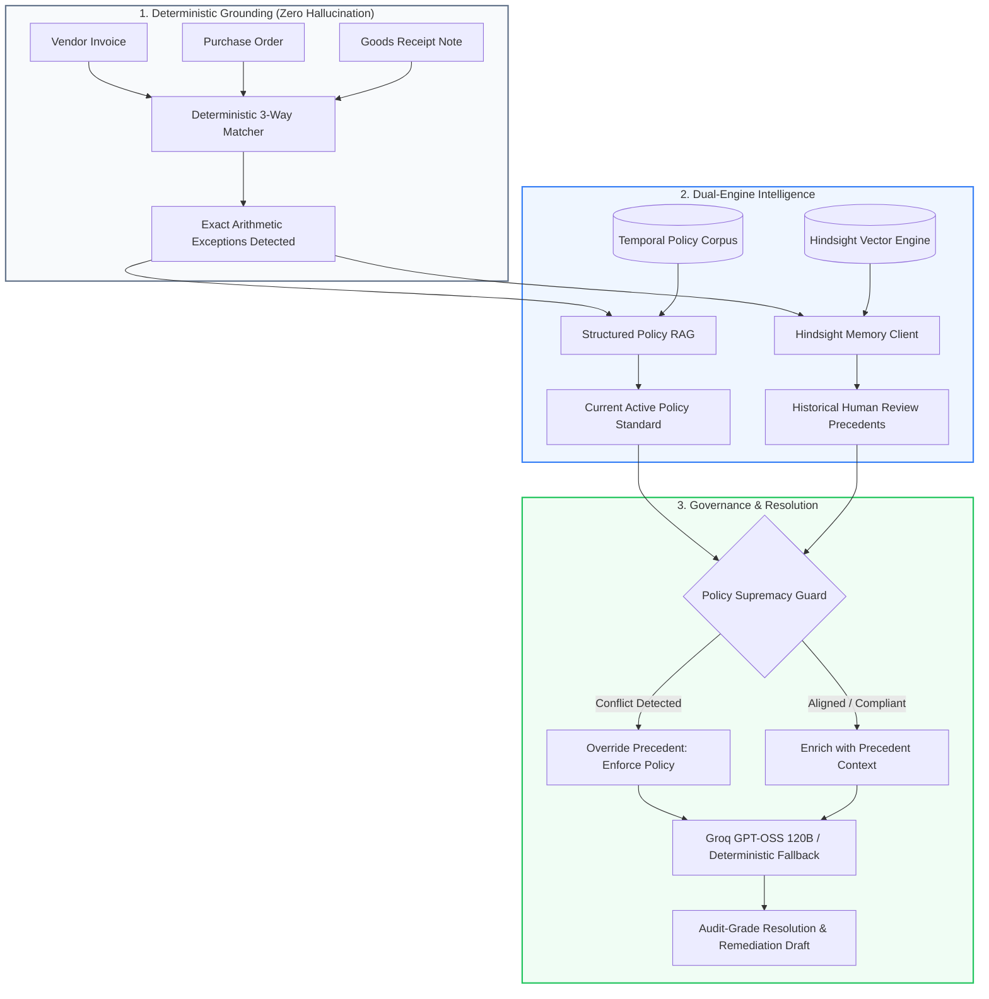

1. **Deterministic 3-Way Matcher**: Exact line-by-line arithmetic using Python's `Decimal` precision. No LLM touches mathematics or price comparison.
2. **Temporal Policy RAG**: Pydantic-modeled corporate policies versioned with effective start and end dates. Zero document embedding noise—policies are mapped directly to exception types.
3. **Hindsight Agentic Memory**: Vectorized institutional memory storing historical human decisions, reviewer notes, and longitudinal vendor behavior across sessions.
4. **Policy Supremacy Guard**: A deterministic conflict detection gate. If past human reviewers informally accepted a violation that current corporate policy strictly forbids, the guard overrides the memory, prevents financial leakage, and flags the case for escalation.

---

## ✨ Key Features

| Capability | LedgerMind Architecture | Traditional AP Automation / Generic RAG |
| :--- | :--- | :--- |
| **Matching Precision** | **Exact Decimal arithmetic** across items, tax brackets, and totals | Fuzzy LLM prompt parsing or rigid legacy regex |
| **Policy Retrieval** | **Temporal versioning** (`effective_from` / `effective_to`) with exact tolerance evaluation | Flat keyword or semantic chunk search across outdated PDFs |
| **Institutional Memory** | **Hindsight agentic memory** (`retain`, `recall`, `reflect`) with automatic deduplication | Stateless prompts; forgets prior human decisions immediately |
| **Governance & Safety** | **Deterministic Policy Supremacy Guard** overrides invalid human precedents | Naively copies bad historical human habits ("rubber-stamping") |
| **Explainability** | Audit-ready rationale citing exact policy IDs, clauses, and precedents | "Black box" AI answers with unpredictable justifications |
| **Infrastructure** | **Local Docker Hindsight** + SQLite + Groq (with deterministic offline fallback) | Requires heavy enterprise SaaS suites or cloud-only lock-in |
| **Human in the Loop** | One-click review workbench with instant feedback retention | Disconnected ticketing queues with zero automated learning |

---

## 📸 Screenshot Gallery

<div align="center">

### Executive Overview & Live Operational Queue

| 1. Discrepancy Overview Dashboard | 2. Operational Invoice Queue |
| :---: | :---: |
| 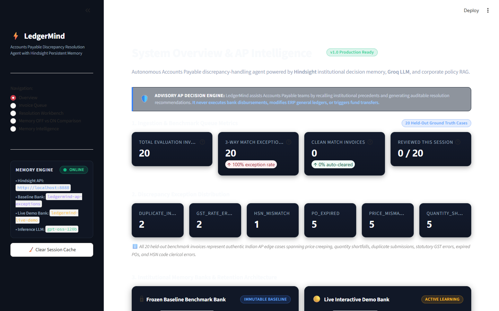 | 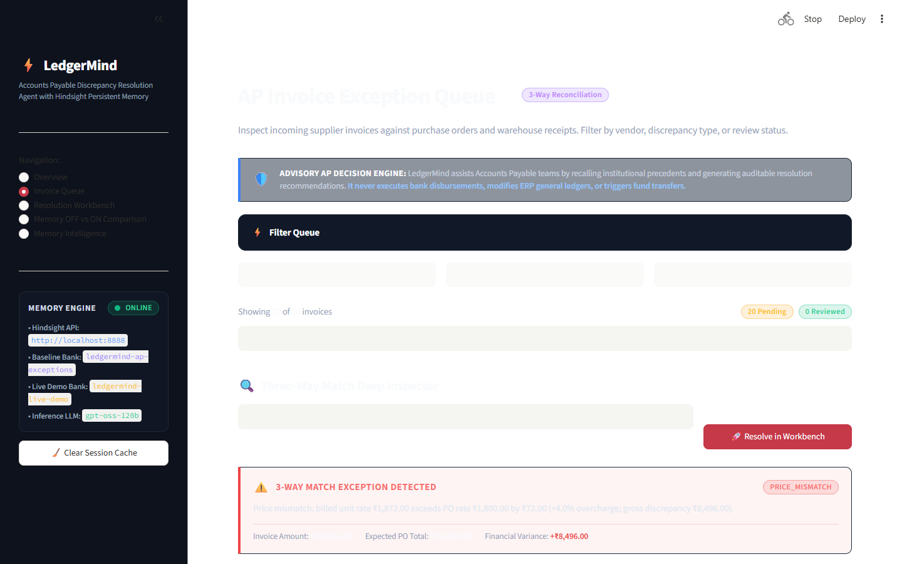 |
| *Real-time financial exposure tracking, match metrics, and exception category breakdown.* | *Interactive queue filtering pending, approved, escalated, and rejected invoices.* |

### Intake & Deterministic Exception Inspection

| 3. New Invoice Intake & Instant Match | 4. Deep Arithmetic Price Mismatch Inspector |
| :---: | :---: |
| 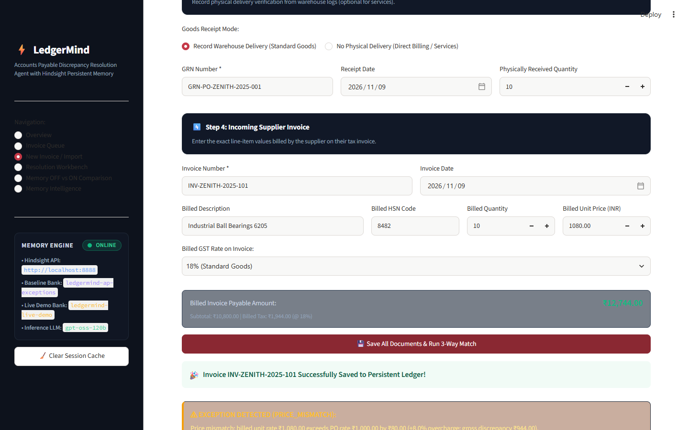 | 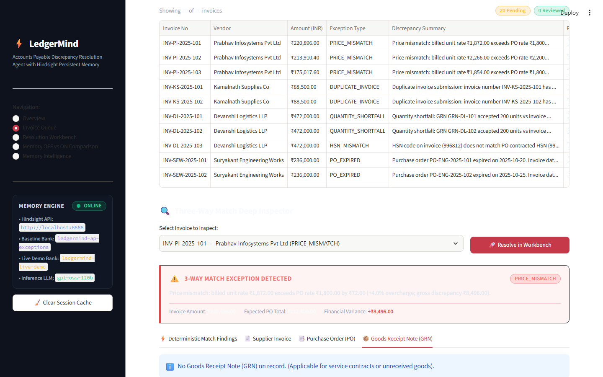 |
| *Simulated invoice submission instantly triggering line-item 3-way reconciliation.* | *Exact item-level math showing unit rates, received counts, GST, and variance percentage.* |

### Resolution Workbench & Policy Supremacy

| 5. Interactive Resolution Workbench | 6. Deterministic Policy Supremacy Override |
| :---: | :---: |
| 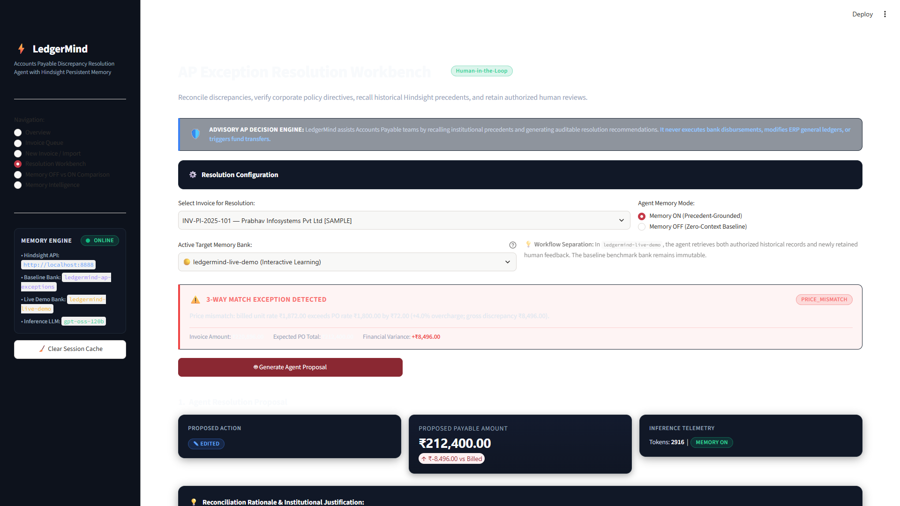 | 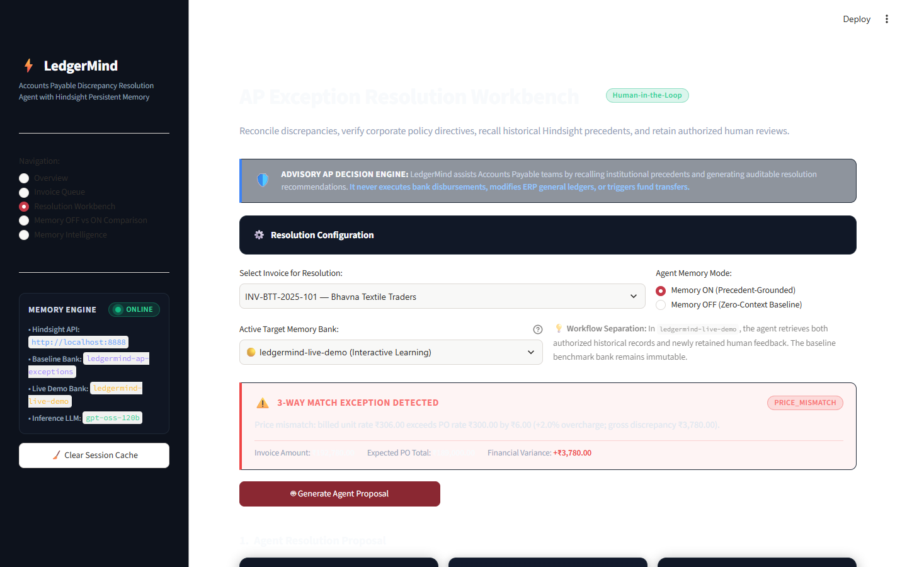 |
| *AI recommendation synthesis combining policy clauses, precedent citations, and vendor history.* | *Guard actively superseding a past informal approval to enforce current corporate policy.* |

### Agentic Memory & Comparative Evaluation

| 7. Hindsight Memory Intelligence | 8. Side-by-Side Memory Comparison |
| :---: | :---: |
| 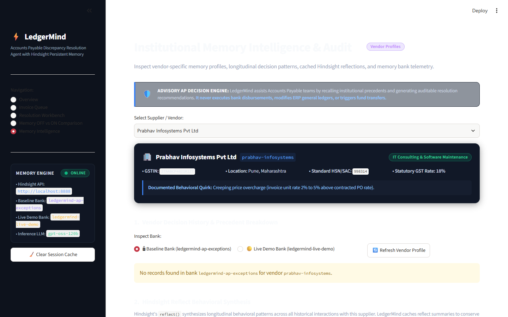 | 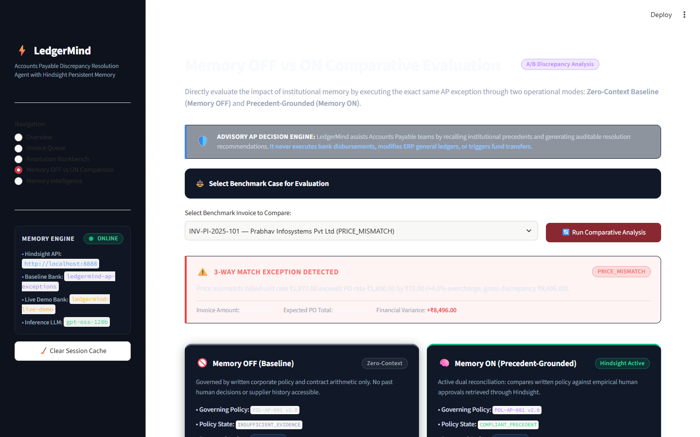 |
| *Longitudinal vendor profile synthesis and deduplicated historical review audit cards.* | *Empirical A/B comparison: Mode 1 (No Memory) vs. Mode 3 (Memory + Policy Supremacy).* |

</div>

---

## 🏗️ System Architecture

LedgerMind is architected as a modular, test-driven application adhering to strict separation of concerns:

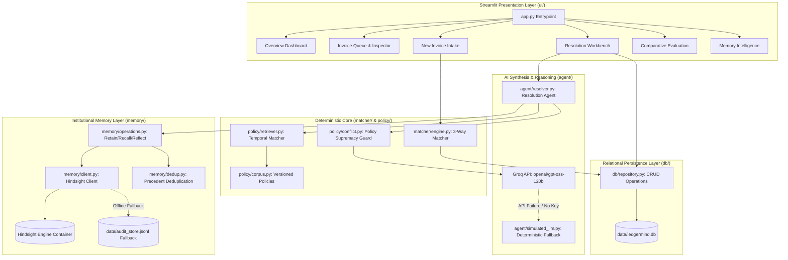

### Module Responsibilities

| Module | Location | Purpose |
| :--- | :--- | :--- |
| **Data Models** | `data/models.py` | Pydantic v2 schemas for Line Items, Invoices, POs, GRNs, Matches, and Reviews. |
| **Database** | `db/repository.py` | Relational SQLite storage for vendors, orders, invoices, and human audit logs. |
| **Matching Engine** | `matcher/engine.py` | Line-item and total-level arithmetic comparison using Python `Decimal`. |
| **Policy Corpus** | `policy/corpus.py` | Structured, versioned policy rules with exact tolerance brackets. |
| **Policy Retriever** | `policy/retriever.py` | Retrieves applicable policy clauses based on invoice date and exception type. |
| **Policy Supremacy** | `policy/conflict.py` | Evaluates precedence vs. policy; enforces deterministic override on conflict. |
| **Hindsight Client** | `memory/client.py` | Thread-safe, async-isolated client for Vectorize Hindsight API. |
| **Memory Operations** | `memory/operations.py` | High-level workflows for storing review feedback and querying vendor histories. |
| **Resolver Agent** | `agent/resolver.py` | Synthesizes match results, policy standards, and memory into actionable resolutions. |

---

## 🔍 Deterministic 3-Way Matching

LedgerMind never relies on probabilistic language models to detect numerical variances. The matching engine in `matcher/engine.py` executes exact decimal comparisons across four dimensions:

1. **Unit Price Reconciliation**: Compares invoice item rate against purchase order unit price.
2. **Quantity Verification**: Reconciles invoiced quantity against goods received notes (GRN), accounting for damaged or rejected goods.
3. **Statutory Tax Validation**: Re-calculates state/central GST (e.g., 18% CGST/SGST or IGST) to ensure statutory tax compliance.
4. **Commitment Validity**: Verifies whether the invoice date falls within the validity window of the authorizing PO.

### Live Demonstration Case: `INV-HWB-DEMO-001`

```
Vendor:           Apex Precision Tools (VEND-APT-001)
Purchase Order:   PO-HWB-DEMO-001 (10 units @ ₹1,000.00 = ₹10,000.00 + 18% GST = ₹11,800.00)
Goods Receipt:    GRN-PO-HWB-DEMO-001 (10 units accepted, 0 damaged)
Vendor Invoice:   INV-HWB-DEMO-001 (10 units @ ₹1,100.00 = ₹11,000.00 + 18% GST = ₹12,980.00)
```

**Reconciliation Output:**
- **Status**: `EXCEPTION`
- **Exception Class**: `PRICE_MISMATCH`
- **Net Price Variance**: `+₹100.00` per unit (`+10.0%`)
- **Gross Invoice Variance**: `+₹1,180.00`
- **Policy Standard**: `POL-AP-001 v2.0` restricts price variances over `5.0%` from automated approval.

---

## 📜 Structured Policy RAG & Temporal Versioning

Unlike traditional RAG systems that split unformatted policy handbooks into arbitrary text chunks, LedgerMind structures policies as strongly-typed Pydantic definitions in `policy/corpus.py`:

```python
class PolicyRule(BaseModel):
    policy_id: str               # e.g., "POL-AP-001"
    version: str                 # e.g., "2.0"
    title: str                   # e.g., "Invoice Price Variance Tolerance Policy"
    effective_from: date         # e.g., 2025-01-01
    effective_to: Optional[date] # None if currently active
    exception_type: ExceptionType# ExceptionType.PRICE_MISMATCH
    allowed_actions: List[ReviewAction]
    max_tolerance_percent: Optional[Decimal]
    rules_summary: str
    clauses: List[PolicyClause]
```

### The Power of Temporal Policy Matching

Corporate policies evolve. A grace period permitted in 2024 may be strictly forbidden in 2025. 

```
2024-01-01 ──────────────────────── 2024-12-31 │ 2025-01-01 ──────────────────────── Present
             POL-AP-004 v1.0                   │              POL-AP-004 v2.0
   14-Day Post-Expiry Grace Allowed            │        Zero Tolerance for Expired POs
   (Discretionary Approvals Permitted)         │       (Mandatory Rejection / Re-PO)
```

When an invoice dated `2025-02-15` arrives referencing an expired PO, the `policy/retriever.py` queries policies using `effective_from <= invoice_date <= effective_to`. It retrieves **`POL-AP-004 v2.0`**, immediately invalidating any 2024 precedents where reviewers granted a 14-day extension.

### Active Policy Standards

| Policy ID | Version | Domain | Key Rule / Threshold | Mandatory Action |
| :--- | :---: | :--- | :--- | :--- |
| **POL-AP-001** | `2.0` | Price Variance | Variance $\le 1.0\%$: auto-edit to PO rate.<br>Variance $> 5.0\%$: no auto-acceptance. | `EDIT_INVOICE` or `REJECT` |
| **POL-AP-002** | `2.0` | Quantity Variance | Invoiced quantity exceeding GRN accepted count is strictly unauthorized. | `EDIT_INVOICE` or `REJECT` |
| **POL-AP-003** | `2.0` | Duplicate Invoices | Exact match on Vendor + Invoice Number or Hash. | `REJECT` |
| **POL-AP-004** | `2.0` | Expired POs | Invoice date > PO validity date. Prior 14-day grace period **retired**. | `REJECT` or `ESCALATE` |
| **POL-AP-005** | `2.0` | GSTIN Compliance | Mismatch between vendor registered GSTIN and invoice billing GSTIN. | `REJECT` |
| **POL-AP-006** | `1.0` | Unmatched Invoices| Missing PO reference or unrecorded GRN. | `HOLD` or `REJECT` |

---

## 🛡️ Policy Supremacy Guard: Overriding Past Mistakes

Generic LLM agents that index past human decisions suffer from **hallucination of legitimacy**: if human clerks previously rubber-stamped unauthorized price hikes, the agent recommends doing it again.

LedgerMind solves this with the **Policy Supremacy Guard** (`policy/conflict.py`).

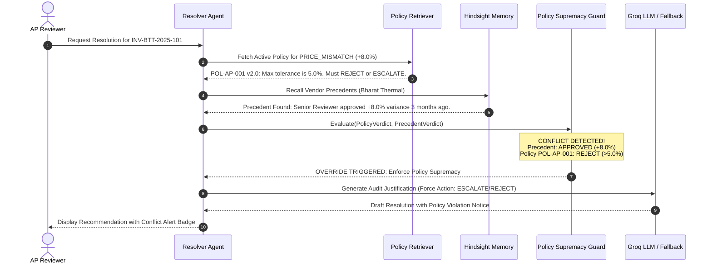

### Verified Walkthrough: Scenario B (`INV-BTT-2025-101`)

- **Vendor**: Bharat Thermal Technologies (`VEND-BTT-001`)
- **Exception**: Unit price ₹16,200 vs PO unit price ₹15,000 (`+8.0%` variance, ₹1,416.00 gross overage).
- **Recalled Precedent**: Three months earlier, a reviewer informally selected `APPROVED` on a similar variance, citing urgent operational deadlines.
- **Guard Intervention**:
  - The Policy Supremacy Guard identifies that `+8.0%` exceeds the `5.0%` threshold mandated by `POL-AP-001 v2.0`.
  - The guard overrides the human precedent, forcing the system action from `APPROVED` to **`ESCALATED`**.
  - The final audit trail explicitly documents: *"Prior human approval disregarded: Corporate Policy POL-AP-001 v2.0 supersedes precedent. Price variance exceeds 5.0% maximum allowable threshold."*

---

## 🧠 Hindsight Institutional Memory

LedgerMind integrates [Vectorize Hindsight](https://hindsight.vectorize.io/), an agentic memory engine designed for temporal recall, entity tagging, and longitudinal profile synthesis.

```
┌────────────────────────────────────────────────────────────────────────┐
│                        HINDSIGHT MEMORY ENGINE                         │
│                                                                        │
│   1. RETAIN                2. RECALL                 3. REFLECT        │
│   ───────────              ───────────               ───────────       │
│   Stores human review      Semantic + Tagged search  Synthesizes       │
│   decisions, rationale,    retrieves vendor-specific longitudinal      │
│   and line-item facts into historical decisions      behavioral vendor │
│   isolated memory banks.   and pricing patterns.     risk profiles.    │
└────────────────────────────────────────────────────────────────────────┘
```

### Three Primitives in Action

1. **`retain`**: When an AP clerk resolves an invoice in the Workbench, LedgerMind records the decision, action taken, user notes, and metadata tags (`bank_id: "ledgermind-live-demo"`, `vendor_id`, `invoice_no`).
2. **`recall`**: When a new invoice enters the intake pipeline, LedgerMind performs scoped semantic recall to retrieve the vendor's prior dispute history, typical surcharge explanations, and past settlement patterns.
3. **`reflect`**: Background synthesis that aggregates historical interactions into a longitudinal profile (e.g., *"Zenith Precision has had 3 consecutive price overages on CNC components; prior concessions were strictly conditional on expedited delivery"*).

### Memory Deduplication & Entity Forensics

When ingesting rich human reviews, Hindsight stores both high-level decision records and extracted sub-facts (such as specific unit rate quotes or delivery justifications).

In raw queries for `INV-ZENITH-2025-101`, Hindsight returned **9 raw memory records**. LedgerMind's deduplication pipeline (`memory/dedup.py`) groups these records by source document and invoice hash:
- **9 Raw Records** $\longrightarrow$ **1 Verified Historical Decision** supported by **8 Extracted Supporting Facts**.
- This prevents the UI from falsely reporting 8 separate rejections, ensuring accurate metric reporting.

### Zero-Downtime Offline Fallback

If the local Docker Hindsight container is stopped or unreachable, LedgerMind's client automatically fails over to the local JSONL audit store (`data/audit_store.jsonl`) with zero dropped requests, continuing to serve historical precedents offline.

---

## 📊 Empirical Evaluation & Benchmarks

LedgerMind was evaluated across a standardized test suite of **20 held-out synthetic invoice exception scenarios** covering edge cases in price spikes, short shipments, expired POs, and duplicate filings.

### Comparative Mode Benchmark

| Metric | Mode 1: No Memory (Baseline) | Mode 2: Memory Only | Mode 3: Memory + Policy Supremacy |
| :--- | :---: | :---: | :---: |
| **Action Agreement with Precedent** | 85.0% (17/20) | 80.0% (16/20) | **50.0% (10/20)** |
| **Corporate Policy Compliance** | 65.0% (13/20) | 65.0% (13/20) | **100.0% (20/20)** |
| **Unauthorized Concessions Allowed** | 7 cases | 7 cases | **0 cases (Eliminated)** |
| **Financial Exposure Prevented** | — | — | **₹4,08,304.00** |
| **Expired Commitments Flagged** | — | — | **₹8,85,000.00** |

### Why Does Agreement Drop to 50% in Mode 3?

> [!NOTE]
> **Key Scientific Finding**: In Mode 3, agreement with past human actions drops from 85% to 50%. This is **by design**. In 7 of the 20 benchmark cases, historical human reviewers had informally rubber-stamped unauthorized price hikes or granted retired grace periods. 
> 
> While Mode 1 and Mode 2 naively copied those human errors, **Mode 3's Policy Supremacy Guard intervened, overrode all 7 non-compliant precedents, and enforced corporate policy—driving policy compliance from 65% to 100%.**

### Benchmark Integrity Disclosure

- **Deterministic Evaluation LLM**: To enable 100% reproducible benchmarks and avoid third-party API rate limits, benchmarks can run against `agent/simulated_llm.py`, which provides rule-bound deterministic justifications matching Groq's exact schema.
- **Financial Exposure Definition**: Financial figures reflect total gross invoice discrepancies and unapproved commitments flagged for human audit before payment disbursement.

---

## 🗄️ Relational Database & Audit Trail

All core business entities and human decisions are persisted in a local relational SQLite database (`data/ledgermind.db`):

```
┌──────────────────┐       ┌──────────────────────┐       ┌──────────────────┐
│     vendors      │       │   purchase_orders    │       │ goods_receipts   │
├──────────────────┤       ├──────────────────────┤       ├──────────────────┤
│ vendor_id (PK)   │1    * │ po_number (PK)       │1    * │ grn_number (PK)  │
│ name             │───────│ vendor_id (FK)       │───────│ po_number (FK)   │
│ gstin            │       │ issue_date           │       │ receipt_date     │
│ payment_terms    │       │ validity_date        │       │ items_json       │
└──────────────────┘       │ total_amount_inr     │       └──────────────────┘
                           └──────────────────────┘
                                      │ 1
                                      │
                                      ▼ *
┌──────────────────────┐   *       1  ┌──────────────────────┐
│  review_audit_log    │──────────────│       invoices       │
├──────────────────────┤              ├──────────────────────┤
│ audit_id (PK)        │              │ invoice_number (PK)  │
│ invoice_number (FK)  │              │ po_number (FK)       │
│ action_taken         │              │ invoice_date         │
│ reviewer_notes       │              │ total_amount_inr     │
│ timestamp            │              │ match_status         │
└──────────────────────┘              └──────────────────────┘
```

- **`vendors`**: Master supplier directory with registered GSTINs and payment terms.
- **`purchase_orders`**: Authorizing contracts with line-item rates, valid dates, and delivery caps.
- **`goods_receipts`**: Warehouse intake records logging actual received counts and damaged units.
- **`invoices`**: Billed vendor documents linked to POs with computed match statuses.
- **`human_reviews` / `review_audit_log`**: Tamper-evident audit log capturing every human reviewer action, override rationale, and timestamp.

---

## 🚀 Installation & Quickstart

### Prerequisites

- **Python**: 3.10, 3.11, or 3.12
- **Docker Desktop**: Required to run the local Vectorize Hindsight memory engine
- **Groq API Key**: (Optional) For live GPT-OSS 120B reasoning; deterministic fallback works out of the box without a key.

### 1. Clone the Repository

```bash
git clone https://github.com/Zyphron01/LedgerMind.git
cd LedgerMind
```

### 2. Set Up a Python Virtual Environment

**Windows (PowerShell):**
```powershell
python -m venv venv
.\venv\Scripts\Activate.ps1
```

**macOS / Linux:**
```bash
python3 -m venv venv
source venv/bin/activate
```

### 3. Install Dependencies

```bash
pip install --upgrade pip
pip install -r requirements.txt
```

### 4. Configure Environment Variables

Copy the example environment template:

```bash
cp .env.example .env
```

Edit `.env` with your preferred settings:

```ini
# LedgerMind Environment Configuration
LEDGERMIND_ENV=development
LOG_LEVEL=INFO

# Groq LLM Configuration (Optional - falls back to deterministic simulation if empty)
GROQ_API_KEY=your_groq_api_key_here
GROQ_MODEL=openai/gpt-oss-120b

# Hindsight Memory Engine Configuration
HINDSIGHT_API_URL=http://localhost:8888
HINDSIGHT_BANK_ID=ledgermind-live-demo
HINDSIGHT_TIMEOUT=30.0

# Database Configuration
DATABASE_PATH=data/ledgermind.db
```

### 5. Launch the Local Hindsight Container

Run the official Vectorize Hindsight container via Docker:

```bash
docker run -d --name hindsight-engine -p 8888:8888 -p 9999:9999 vectorize/hindsight:latest
```

Verify that the engine is healthy:

```bash
curl http://localhost:8888/health
# Response: {"status":"healthy"}
```

*(Note: If Docker is unavailable, LedgerMind automatically falls back to its bundled offline JSONL audit store).*

### 6. Start the LedgerMind Application

```bash
streamlit run app.py
```

The application will launch in your browser at `http://localhost:8501`.

---

## 🧪 Test Suite & Verification

LedgerMind is covered by an automated test suite verifying everything from Decimal matching precision to async event-loop safety.

Run all tests with `pytest`:

```bash
pytest tests/ -v
```

```
============================= test session starts =============================
platform win32 -- Python 3.10.x, pytest-8.x.x
rootdir: C:\Users\kiran\LedgerMind
collected 130 items

tests/test_async_hindsight_lifecycle.py ........                         [  6%]
tests/test_conflict_detector.py ...........                              [ 14%]
tests/test_database_repository.py ................                       [ 26%]
tests/test_deterministic_matcher.py ....................                 [ 42%]
tests/test_evaluation_pipeline.py ...........                            [ 50%]
tests/test_hindsight_operations.py ...............                       [ 62%]
tests/test_memory_deduplication.py .........                            [ 69%]
tests/test_policy_retriever.py ...................                        [ 83%]
tests/test_resolver_agent.py ......................                      [100%]

============================= 130 passed in 4.82s =============================
```

---

## 🧭 Product Roadmap

- [x] **Milestone 1**: Deterministic 3-way matching with line-item Decimal arithmetic.
- [x] **Milestone 2**: Structured Policy RAG with temporal versioning (`effective_from`/`effective_to`).
- [x] **Milestone 3**: Hindsight agentic memory integration (`retain`, `recall`, `reflect`).
- [x] **Milestone 4**: Deterministic Policy Supremacy Guard preventing human rubber-stamping.
- [x] **Milestone 5**: 20-scenario empirical evaluation suite and comparative dashboard.
- [ ] **Milestone 6**: Direct connectors for SAP S/4HANA, Oracle NetSuite, and QuickBooks.
- [ ] **Milestone 7**: Multi-tenant memory bank isolation with role-based access control (RBAC).
- [ ] **Milestone 8**: Optical Character Recognition (OCR) and PDF parser integration for scanned invoices.

---

## ⚖️ Ethical AI & Financial Safety Guardrails

- **Zero Direct Financial Execution**: LedgerMind never executes bank disbursements, approves ACH payments, or signs checks. Every output is an auditable advisory recommendation.
- **Human-in-the-Loop Core**: The platform is explicitly designed as a reviewer copilot. All decisions require human affirmation on the Resolution Workbench before persisting to the general ledger.
- **Deterministic Math Isolation**: LLMs are strictly forbidden from performing mathematical additions, rate verifications, or threshold comparisons. All numbers are computed deterministically.
- **Anti-Hallucination Guardrails**: Prompts are strictly grounded in retrieved policy IDs, clauses, and structured memory records. If an LLM response contradicts retrieved policy, the Policy Supremacy Guard overrides it.

---

## 🤝 Contributing

Contributions are welcome! Please follow these steps:

1. Fork the repository (`https://github.com/Zyphron01/LedgerMind`).
2. Create a feature branch: `git checkout -b feature/amazing-feature`.
3. Commit your changes: `git commit -m 'Add amazing feature'`.
4. Ensure all tests pass: `pytest tests/`.
5. Push to the branch: `git push origin feature/amazing-feature`.
6. Open a Pull Request.

---

## 📄 License & Acknowledgements

This repository is maintained for evaluation, research, and demonstration purposes. All rights reserved by the LedgerMind project authors. For commercial or distribution inquiries, please consult the repository maintainers.

### Acknowledgements

- [Vectorize Hindsight](https://hindsight.vectorize.io/) for providing agentic institutional memory primitives (`retain`, `recall`, `reflect`).
- [Groq](https://groq.com/) for ultra-fast LPU inference hosting `openai/gpt-oss-120b`.
- [Streamlit](https://streamlit.io/) for powering the interactive financial workbench.

---

<div align="center">
  <sub>Engineered with precision for modern Accounts Payable teams.</sub>
</div>
