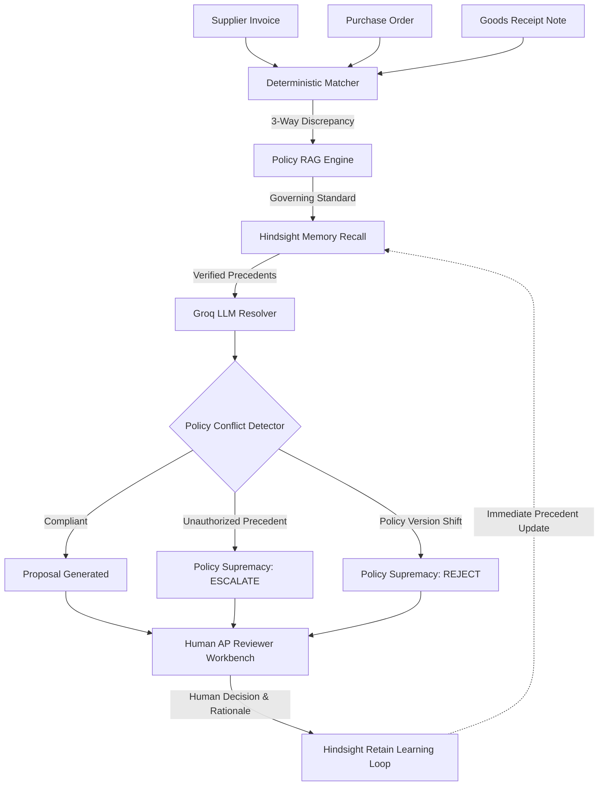

# LedgerMind ⚡
### Autonomous Accounts-Payable Exception-Handling Agent Powered by Hindsight Agentic Memory & Policy RAG

> **Advisory Financial Intelligence Notice**: LedgerMind assists Accounts Payable teams by recalling institutional human precedents and generating auditable resolution recommendations. **It never executes bank disbursements, modifies ERP general ledgers, or authorizes direct financial transfers.** All corporate policies and business vendor profiles are synthetic simulations.

---

## 1. System Overview & Problem Statement

Accounts Payable (AP) departments face recurring 3-way match discrepancies (Invoice vs. Purchase Order vs. Goods Receipt Note). Traditional rule-based AP automation tools fail when discrepancies require context:
- Did the approver accept previous minor variances due to standard packaging increments or freight rounding?
- Has the supplier repeatedly billed unauthorized price overages that reviewers informally rubber-stamped?
- Has corporate policy recently retired historical grace periods, making past approvals obsolete?

**LedgerMind** solves this through **Policy-Aware Institutional Decision Memory**:
1. **Deterministic 3-Way Matcher**: Rapid, zero-hallucination detection of price mismatches, quantity shortfalls, duplicate submissions, statutory GST errors, and expired POs in plain Python.
2. **Deterministic Policy RAG**: Temporal retrieval of internal corporate policies with exact effective dates and variance thresholds.
3. **Hindsight Persistent Agent Memory**: Vector and document-level recall of prior human approver decisions, cited evidence, and vendor profile reflections.
4. **Autonomous Resolution Agent**: Groq LLM (`openai/gpt-oss-120b`) formulates structured proposals grounded in recalled precedents.
5. **Deterministic Policy Supremacy Guard**: Written corporate policy strictly supersedes precedent. The system prevents repeated unauthorized historical approvals from violating active financial controls.
6. **Continuous Learning Loop**: Human reviewers approve, edit, or escalate proposals, immediately retaining verified rationale back into Hindsight for subsequent invoice evaluations.

---

## 2. Core Architecture



---

## 3. How LedgerMind Uses Hindsight Agent Memory

LedgerMind uses all three core capabilities of Hindsight (`retain`, `recall`, and `reflect`):

1. **`retain()` — Auditable Institutional Learning**:
   When a human AP reviewer approves, edits, or escalates an invoice in the Resolution Workbench, their decision, role, final payable amount, and mandatory audit justification are retained into the active `ledgermind-live-demo` bank:
   ```python
   client.retain(
       bank_id="ledgermind-live-demo",
       content=f"Resolution Decision: {submission.human_decision.value} ...",
       document_id=f"feedback-{submission.invoice_number}-{uuid.uuid4().hex[:8]}",
       tags=[f"vendor:{slug}", f"exception:{exc}", f"decision:{decision}"]
   )
   ```
   *Baseline Benchmark Isolation*: Writes to the frozen benchmark bank (`ledgermind-ap-exceptions`) are strictly blocked to preserve benchmark integrity.

2. **`recall()` — Evidence-Grounded Precedent Retrieval**:
   When resolving an exception, the agent queries Hindsight using vendor slugs and exception categories:
   ```python
   recalled = client.recall(
       bank_id="ledgermind-live-demo",
       query=f"Historical decisions and invoice reviews for {vendor_name} with {exception_type}",
       tags=[f"vendor:{slug}", f"exception:{exc}"],
       limit=5
   )
   ```
   *Strict Anti-Hallucination & Deduplication*: Recalled facts from the same source document are deduplicated. The agent calculates a deterministic heuristic confidence score and strictly enforces citation validity.

3. **`reflect()` — Longitudinal Vendor Behavioral Profiling**:
   Hindsight's `reflect()` synthesizes long-term behavioral patterns across all historical interactions with a supplier (e.g., standard packing overages, freight adjustments, or recurring billing quirks):
   ```python
   summary = client.reflect(
       bank_id="ledgermind-live-demo",
       query=f"Summarize longitudinal relationship, recurring invoice patterns, and billing habits for {vendor_name}."
   )
   ```
   Reflect summaries are cached on disk (`reflect_cache.json`) to conserve LLM token budgets.

---

## 4. Benchmark Demonstration Scenarios

LedgerMind includes three reproducible benchmark scenarios demonstrating the balance between institutional memory and corporate policy controls:

### Scenario A — Compliant Precedent (Prabhav Infosystems)
- **Invoice**: `INV-PI-2025-101` (Prabhav Infosystems Pvt Ltd)
- **Discrepancy**: Price mismatch (+4.0% overcharge; unit rate ₹1,872 vs contracted ₹1,800).
- **Governing Policy**: `POL-AP-001` v2.0 (Price overages between 1.0% and 5.0% must be EDITED down to contracted rate).
- **Precedents**: Historical approvers consistently edited prior overcharges (`decision-INV-PI-2024-001`).
- **Outcome**: **`EDITED` to ₹212,400.00** (Confidence 0.70, Medium). Precedent perfectly complies with written policy.

### Scenario B — Policy–Precedent Conflict (Bhavna Textile Traders)
- **Invoice**: `INV-BTT-2025-101` (Bhavna Textile Traders)
- **Discrepancy**: Price mismatch (+2.00% price variance).
- **Governing Policy**: `POL-AP-001` v2.0 (Caps unamended price tolerance at 1.00%; strictly prohibits unamended approvals).
- **Precedents**: Past human approvers repeatedly rubber-stamped prior overcharges (`decision-INV-BTT-2024-001`).
- **Outcome**: **`ESCALATED` to Procurement Category Lead / Finance Controller** (Confidence 0.10, Low). Deterministic Policy Supremacy overrides bad habits and flags unauthorized precedent.

### Scenario C — Policy Version Shift (Suryakant Engineering Works)
- **Invoice**: `INV-SEW-2025-101` (Suryakant Engineering Works)
- **Discrepancy**: PO Expired (Invoice submitted 18 days after PO validity date).
- **Governing Policy**: `POL-AP-004` v2.0 (Effective 2025-08-01; strictly abolishes grace periods; mandates immediate rejection).
- **Precedents**: Historical approvals occurred under retired policy v1.0, which permitted a 30-day grace period.
- **Outcome**: **`REJECTED`** (Confidence 0.05, Low). Current active policy strictly supersedes obsolete historical precedent.

---

## 5. Verified Hindsight Environment & Setup

LedgerMind integrates with [Hindsight](https://hindsight.vectorize.io/) (Agent Memory by Vectorize).

### Verified Container Specification
- **Image**: `ghcr.io/vectorize-io/hindsight:latest`
- **Image Manifest Digest**: `sha256:60fcc7b8134723e83b2caa2b6feeb98fdefa99aa4265e3c483011a31657207b9`
- **Container Name**: `hindsight`
- **API Port**: `8888`
- **Control Plane Port**: `9999`
- **Persistent Volume Mount**: `hindsight-data:/home/hindsight/.pg0` (Internal container storage directory)

### Reproduction Command
To start the verified Hindsight container locally:

```bash
docker run -d --name hindsight \
  -p 8888:8888 -p 9999:9999 \
  -v hindsight-data:/home/hindsight/.pg0 \
  -e HINDSIGHT_API_LLM_PROVIDER=groq \
  -e HINDSIGHT_API_LLM_API_KEY="<YOUR_GROQ_API_KEY>" \
  -e HINDSIGHT_API_LLM_MODEL=openai/gpt-oss-120b \
  -e HINDSIGHT_API_LLM_GROQ_SERVICE_TIER=on_demand \
  -e HINDSIGHT_API_WORKER_ID=ledgermind-local \
  -e HINDSIGHT_ENABLE_API=true \
  -e HINDSIGHT_ENABLE_CP=true \
  ghcr.io/vectorize-io/hindsight:latest
```

---

## 6. Quickstart Guide

### Prerequisites
- Python 3.11+
- Local Docker Desktop (or run LedgerMind in transparent offline fallback mode)
- Groq API Key (for LLM inference)

### Installation
```bash
git clone https://github.com/your-username/LedgerMind.git
cd LedgerMind

python -m venv venv
# Windows:
venv\Scripts\activate
# Linux/macOS:
source venv/bin/activate

pip install -r requirements.txt
```

### Environment Configuration
Copy the example environment template:
```bash
cp .env.example .env
```
Edit `.env`:
```env
HINDSIGHT_MODE=local             # local | cloud | offline
HINDSIGHT_LOCAL_URL=http://localhost:8888
GROQ_API_KEY=gsk_your_groq_api_key_here
GROQ_MODEL=openai/gpt-oss-120b
```

### Run Streamlit Application
```bash
streamlit run app.py
```
Open [http://localhost:8501](http://localhost:8501) in your browser.

---

## 7. Automated Verification & Benchmarks

### Run 57-Test Regression Suite
```bash
python -m pytest -v
```

### Run Policy Conflict Benchmark Scenarios (Scenarios A, B, C)
```bash
python scripts/demo_policy_conflicts.py --mode offline
# or with live local Hindsight:
python scripts/demo_policy_conflicts.py --mode local
```

### Run 20-Invoice Held-Out Evaluation
```bash
python eval/evaluate_held_out.py --client-mode offline
# or with live local Hindsight:
python eval/evaluate_held_out.py --client-mode local
```

---

## 8. Evaluation Summary (N = 20 Held-Out Invoices)

Comparison across 20 held-out invoices evaluated against isolated ground-truth labels:

| Evaluation Metric | Mode 1 (Memory OFF) | Mode 2 (Precedent Only) | Mode 3 (LedgerMind Full) |
| :--- | :---: | :---: | :---: |
| **Action Agreement** | 17/20 (85.0%) | 16/20 (80.0%) | 10/20 (50.0%)* |
| **Amount Accuracy** | 15/20 (75.0%) | 14/20 (70.0%) | 14/20 (70.0%) |
| **Policy Compliance** | 13/20 (65.0%) | 13/20 (65.0%) | **20/20 (100.0%)** |
| **Citation Validity** | 100.0% | 100.0% | **100.0%** |
| **Average Latency** | 0.2 ms | 6.8 ms | 6.5 ms |

*\*Note on Action Agreement: Mode 2 blindly rubber-stamps unauthorized historical human approvals (e.g. informal price overages and retired grace periods). Mode 3 strictly prioritizes written corporate policy, achieving 100% Policy Compliance by escalating unauthorized approvals and rejecting expired POs under active standards.*

---

## 9. Disclaimers & Known Limitations

1. **Synthetic Data Disclaimer**: All 8 vendors (e.g. *Prabhav Infosystems*, *Bhavna Textile Traders*, *Patel Hardware & Tools*), GSTINs, invoice line items, purchase orders, and corporate policies (`POL-AP-001` through `POL-AP-006`) are synthetically generated for demonstration and evaluation purposes.
2. **Groq Free-Tier Rate Limits**: Groq's free-tier ceiling is 200,000 Tokens Per Day (TPD). In the local Hindsight bank, 14 initial documents were seeded directly, and remaining records are queued or served via the local offline fallback store (`offline_memory.jsonl`).
3. **Deterministic Heuristic Confidence**: The confidence score (0.00–1.00) is a deterministic metric reflecting sample size (n) and historical approver agreement ratio, not a calibrated Bayesian posterior probability.
4. **Advisory Financial Intelligence**: LedgerMind does not connect to bank gateways, write to ERP general ledgers, or execute automated disbursements. All decisions require human reviewer confirmation.
