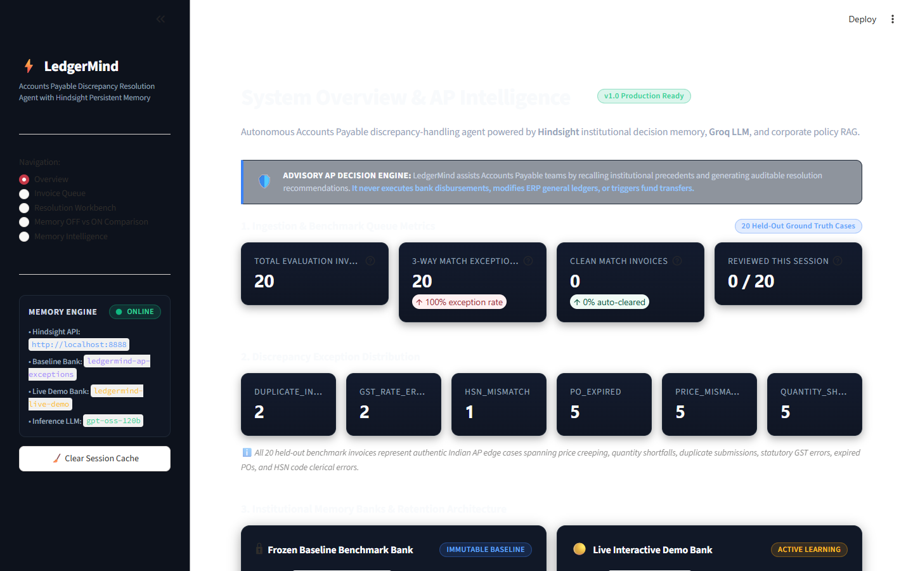
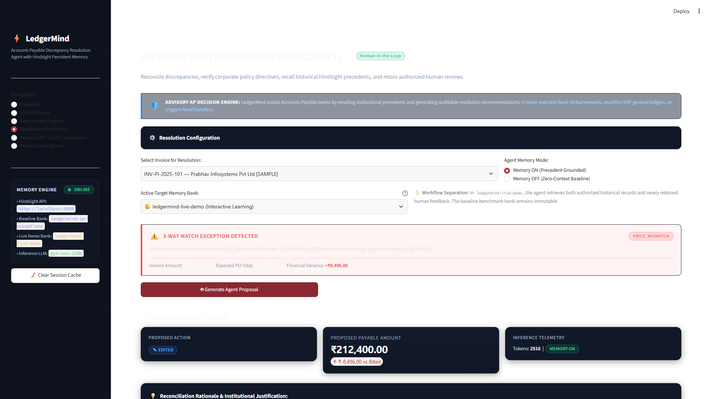
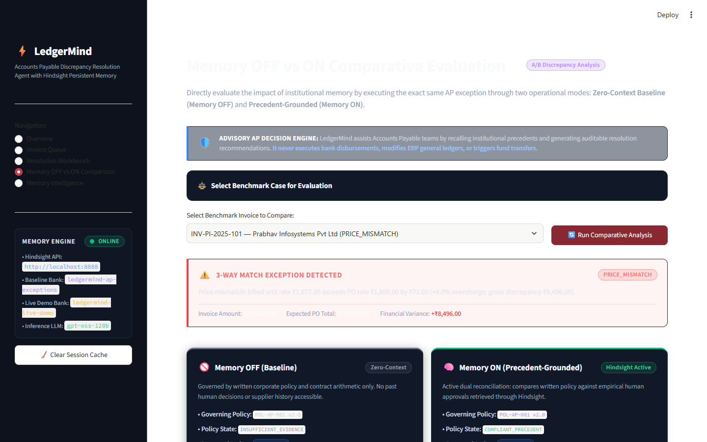
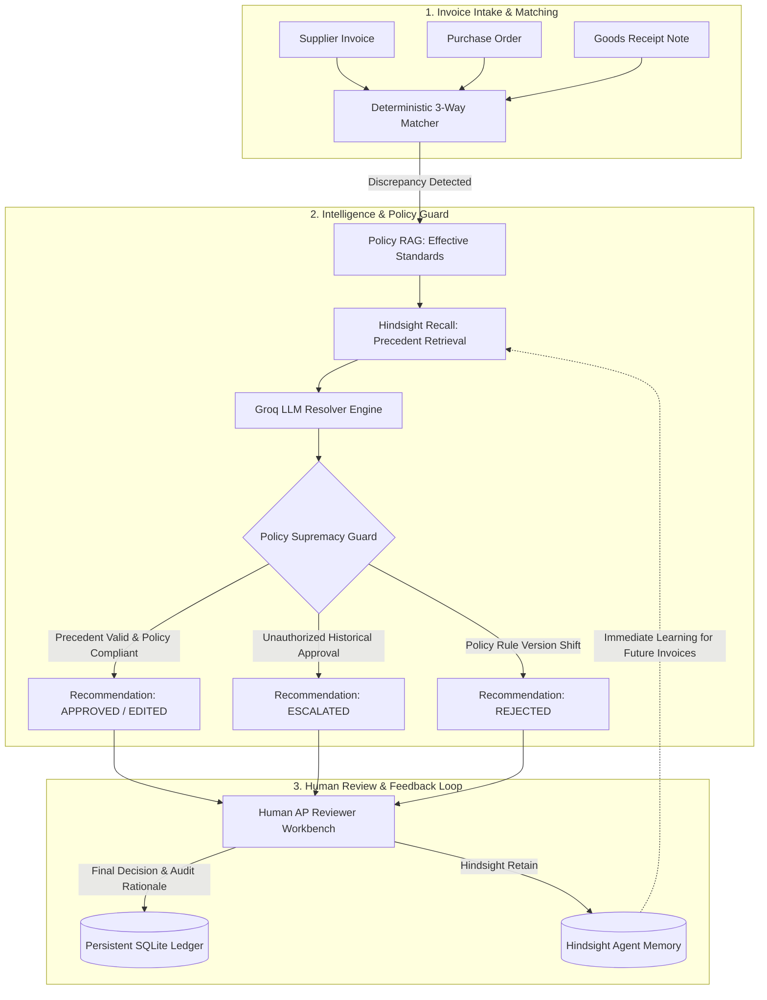

# LedgerMind ⚡
### Autonomous Accounts-Payable Exception-Handling Agent Powered by Hindsight Agentic Memory & Policy RAG

> **Advisory Financial Intelligence Notice**: LedgerMind assists Accounts Payable (AP) teams by recalling institutional human precedents and generating auditable resolution recommendations. **It never executes bank disbursements, modifies ERP general ledgers, or authorizes direct financial transfers.** All corporate policies, vendors, GSTINs, and purchase orders in the baseline demonstration are synthetic simulations.

---

## 1. Executive Summary & Problem Statement

In enterprise Accounts Payable, 3-way matching discrepancies (Invoice vs. Purchase Order vs. Goods Receipt Note) create high-friction operational bottlenecks. While simple arithmetic checks detect variances, resolving them requires institutional memory:
- Did the approver previously accept minor price variances due to standard packaging increments or freight rounding?
- Has the supplier repeatedly billed unauthorized price overages that reviewers informally rubber-stamped?
- Has corporate policy recently retired historical grace periods, making past approvals obsolete?

Traditional automated systems either blindly approve variances (risking financial leakage) or halt execution completely, overwhelming human AP clerks.

**LedgerMind** bridges this gap using **Policy-Aware Institutional Decision Memory**. It combines deterministic matching, temporal corporate policy retrieval, and persistent agentic memory to propose explainable, audit-ready resolutions while ensuring that **written corporate policy strictly supersedes precedent**.

---

## 2. Key Capabilities & Screenshots

| 1. Discrepancy Queue & Inspector | 2. Resolution Workbench & Precedent Citations |
| :---: | :---: |
|  |  |
| *Multi-document reconciliation with instant exception badging.* | *Precedent grounding with Policy Supremacy conflict overrides.* |

| 3. Memory OFF vs ON Comparative Evaluation |
| :---: |
|  |
| *Side-by-side empirical confidence uplift and evidentiary audit trails.* |

---

## 3. The Four Pillars of LedgerMind

1. **Deterministic 3-Way Matcher (Zero Hallucination)**:
   - Performs exact arithmetic verification of line-item prices, received quantities, statutory Indian GST calculations, duplicate invoice detection, and purchase order expiration dates using Python's `Decimal`.
2. **Deterministic Policy RAG Engine**:
   - Temporally retrieves active corporate policy standards (e.g., `POL-AP-001` through `POL-AP-006`) based on invoice issuance dates, comparing variances against exact allowed thresholds.
3. **Hindsight Agentic Memory**:
   - Integrates [Vectorize Hindsight](https://hindsight.vectorize.io/) across all three memory primitives (`retain`, `recall`, `reflect`) to maintain persistent, cross-session precedent memory of prior human reviewer decisions, justifications, and longitudinal vendor profiles.
4. **Policy Supremacy Guard & Autonomous Resolver**:
   - Formulates resolution recommendations via Groq LLM (`openai/gpt-oss-120b`). If a historical precedent conflicts with active corporate policy (such as past rubber-stamping or retired grace periods), the Policy Supremacy Guard overrides precedent, forcing escalation or rejection.

---

## 4. Technology Stack

- **Application Framework**: Python 3.10+ / Streamlit
- **Agent Memory Engine**: [Vectorize Hindsight](https://hindsight.vectorize.io/) (Docker container on port `8888`) with resilient fallback to local JSONL store
- **Large Language Model (LLM)**: Groq API (`openai/gpt-oss-120b` with automatic fallback to `openai/gpt-oss-20b`)
- **Persistence Layer**: SQLite (`data/ledgermind.db`) with Decimal-safe string serialization
- **Policy Engine**: In-memory temporal policy corpus with strict version-scoping
- **Test Suite**: Pytest (75 unit and integration tests)

---

## 5. System Architecture & Workflow



### End-to-End Operational Lifecycle:
1. **Invoice Intake**: The user creates or imports an invoice, linking it to an existing or newly generated Purchase Order and Goods Receipt Note.
2. **3-Way Match Execution**: LedgerMind compares unit prices, delivered quantities, and tax calculations, identifying any exceptions (e.g., price overages, quantity shortages, expired POs).
3. **Memory Retrieval & Policy Retrieval**:
   - Governing corporate policy is retrieved with exact effective dates.
   - Hindsight recalls prior decisions for this vendor and exception type.
4. **Recommendation Generation**: Groq LLM synthesizes policy and precedents to formulate a proposed action (`APPROVE`, `EDIT`, `REJECT`, `ESCALATE`).
5. **Human Review & Permanent Retention**: An AP specialist inspects the evidence, confirms or edits the resolution, and submits the review. The decision is saved to the SQLite ledger and immediately retained in Hindsight for future precedent recall.

---

## 6. Live Hindsight vs. Offline JSONL Fallback Provenance

LedgerMind is architected for continuous resilience:

| Capability | Live Local Hindsight Mode (`HINDSIGHT_MODE=local`) | Offline JSONL Fallback Mode (`HINDSIGHT_MODE=offline`) |
| :--- | :--- | :--- |
| **Backend Engine** | Vectorize Hindsight Docker container (REST on `:8888`) | Local JSONL append-only audit files (`offline_memory.jsonl`) |
| **Retrieval Method** | Semantic vector similarity + tag-filtered recall | Tag-based keyword and metadata exact filtering |
| **Longitudinal Insights** | Dynamic `reflect()` behavioral summaries | Local cached reflection summaries (`reflect_cache.json`) |
| **Provenance Indication** | `Hindsight Bank: ledgermind-live-demo` (Green chip in UI) | `Offline JSONL Fallback Store` (Amber chip in UI) |
| **Automatic Fallback** | Automatically falls back to JSONL if container is unreachable or times out (>30s) | Operates completely air-gapped without Docker or network |

Every memory card displayed in the Resolution Workbench explicitly discloses its data lineage so the human auditor knows whether evidence was retrieved via semantic vector search or offline fallback.

---

## 7. How LedgerMind Uses Hindsight Agent Memory

LedgerMind leverages all three core primitives of Hindsight:

1. **`retain()` — Auditable Precedent Learning**:
   When an AP specialist approves, edits, or escalates an invoice, their decision, role, payable amount, and audit rationale are permanently retained into Hindsight:
   ```python
   client.retain(
       bank_id="ledgermind-live-demo",
       content=f"Resolution Decision: {submission.human_decision.value} ...",
       document_id=f"feedback-{submission.invoice_number}-{uuid.uuid4().hex[:8]}",
       tags=[f"vendor:{slug}", f"exception:{exc}", f"decision:{decision}"]
   )
   ```
2. **`recall()` — Evidence-Grounded Precedent Retrieval**:
   When evaluating a new exception, LedgerMind recalls historical decisions matching the vendor and exception type:
   ```python
   recalled = client.recall(
       bank_id="ledgermind-live-demo",
       query=f"Historical decisions and invoice reviews for {vendor_name} with {exception_type}",
       tags=[f"vendor:{slug}", f"exception:{exc}"],
       limit=5
   )
   ```
   *Deduplication & Circular-Evidence Guard*: Facts belonging to the same review document are deduplicated into a single logical evidence card. The system strictly excludes an invoice's own historical review from being used as precedent against itself.
3. **`reflect()` — Longitudinal Vendor Behavioral Profiling**:
   Hindsight synthesizes cross-invoice patterns to provide context on recurring supplier billing behaviors:
   ```python
   summary = client.reflect(
       bank_id="ledgermind-live-demo",
       query=f"Summarize longitudinal relationship and recurring invoice patterns for {vendor_name}."
   )
   ```

---

## 8. Benchmark Scenarios (Policy vs. Precedent)

LedgerMind includes three benchmark scenarios demonstrating its core differentiator:

### Scenario A — Compliant Precedent (Prabhav Infosystems)
- **Invoice**: `INV-PI-2025-101` (Prabhav Infosystems Pvt Ltd)
- **Discrepancy**: Price mismatch (+4.0% overcharge; unit rate ₹1,872 vs contracted ₹1,800).
- **Governing Policy**: `POL-AP-001` v2.0 (Price overages between 1.0% and 5.0% must be EDITED down to contracted rate).
- **Precedent**: Historical approvers consistently edited prior overcharges (`decision-INV-PI-2024-001`).
- **Outcome**: **`EDITED` to ₹212,400.00** (Confidence 0.70, Medium). Precedent complies with policy.

### Scenario B — Policy–Precedent Conflict (Bhavna Textile Traders)
- **Invoice**: `INV-BTT-2025-101` (Bhavna Textile Traders)
- **Discrepancy**: Price mismatch (+2.00% price variance).
- **Governing Policy**: `POL-AP-001` v2.0 (Caps unamended price tolerance at 1.00%; strictly prohibits unamended approvals).
- **Precedent**: Past human approvers repeatedly rubber-stamped prior overcharges without amendment.
- **Outcome**: **`ESCALATED` to Procurement Category Lead** (Confidence 0.10, Low). Deterministic Policy Supremacy overrides rubber-stamped precedent.

### Scenario C — Policy Version Shift (Suryakant Engineering Works)
- **Invoice**: `INV-SEW-2025-101` (Suryakant Engineering Works)
- **Discrepancy**: PO Expired (Invoice submitted 18 days after PO validity date).
- **Governing Policy**: `POL-AP-004` v2.0 (Effective 2025-08-01; strictly abolishes grace periods; mandates immediate rejection).
- **Precedent**: Historical approvals occurred under retired policy v1.0, which permitted a 30-day grace period.
- **Outcome**: **`REJECTED`** (Confidence 0.05, Low). Active corporate policy strictly supersedes obsolete historical precedent.

---

## 9. Hindsight Docker Setup

LedgerMind integrates with [Hindsight](https://hindsight.vectorize.io/) (Agent Memory by Vectorize).

### Container Specification
- **Image**: `ghcr.io/vectorize-io/hindsight:latest`
- **Image Digest**: `sha256:60fcc7b8134723e83b2caa2b6feeb98fdefa99aa4265e3c483011a31657207b9`
- **API Port**: `8888`
- **Control Plane Port**: `9999`
- **Persistent Volume**: `hindsight-data:/home/hindsight/.pg0`

### Start Hindsight Locally
```bash
docker run -d --name hindsight \
  -p 8888:8888 -p 9999:9999 \
  -v hindsight-data:/home/hindsight/.pg0 \
  -e HINDSIGHT_API_LLM_PROVIDER=groq \
  -e HINDSIGHT_API_LLM_API_KEY="<YOUR_GROQ_API_KEY>" \
  -e HINDSIGHT_API_LLM_MODEL=openai/gpt-oss-120b \
  -e HINDSIGHT_API_LLM_GROQ_SERVICE_TIER=on_demand \
  -e HINDSIGHT_API_WORKER_ID=ledgermind-local \
  -e HINDSIGHT_ENABLE_API=true \
  -e HINDSIGHT_ENABLE_CP=true \
  ghcr.io/vectorize-io/hindsight:latest
```

---

## 10. Quickstart Installation & Execution

### Prerequisites
- Python 3.10 or higher
- Groq API Key (for LLM resolution generation)
- Local Docker Desktop (optional: LedgerMind runs transparently in offline fallback mode if Docker is absent)

### Installation
```bash
git clone https://github.com/Zyphron01/LedgerMind.git
cd LedgerMind

python -m venv venv
# Windows:
venv\Scripts\activate
# Linux/macOS:
source venv/bin/activate

pip install -r requirements.txt
```

### Environment Configuration
Copy the example environment configuration:
```bash
cp .env.example .env
```
Edit `.env` to configure your keys:
```env
HINDSIGHT_MODE=local                           # local | cloud | offline
HINDSIGHT_LOCAL_URL=http://localhost:8888
GROQ_API_KEY=gsk_your_groq_api_key_here        # required for live agent recommendations
GROQ_MODEL=openai/gpt-oss-120b
```

### Run Application
```bash
streamlit run app.py
```
Open [http://localhost:8501](http://localhost:8501) in your browser.

---

## 11. Automated Tests & Evaluation Suite

### Run 75-Test Regression Suite
```bash
python -m pytest -v
```

### Run Policy Conflict Benchmark Scenarios
```bash
python scripts/demo_policy_conflicts.py --mode offline
# or with live local Hindsight:
python scripts/demo_policy_conflicts.py --mode local
```

### Run 20-Invoice Held-Out Evaluation
```bash
python eval/evaluate_held_out.py --client-mode offline
# or with live local Hindsight:
python eval/evaluate_held_out.py --client-mode local
```

### Held-Out Evaluation Benchmark (N = 20 Invoices)

| Evaluation Metric | Mode 1 (Memory OFF) | Mode 2 (Precedent Only) | Mode 3 (LedgerMind Full) |
| :--- | :---: | :---: | :---: |
| **Action Agreement** | 17/20 (85.0%) | 16/20 (80.0%) | 10/20 (50.0%)* |
| **Amount Accuracy** | 15/20 (75.0%) | 14/20 (70.0%) | 14/20 (70.0%) |
| **Policy Compliance** | 13/20 (65.0%) | 13/20 (65.0%) | **20/20 (100.0%)** |
| **Citation Validity** | 100.0% | 100.0% | **100.0%** |
| **Average Latency** | 0.2 ms | 6.8 ms | 6.5 ms |

*\*Note on Action Agreement: Mode 2 blindly rubber-stamps unauthorized historical human approvals (e.g. informal price overages and retired grace periods). Mode 3 strictly prioritizes written corporate policy, achieving 100% Policy Compliance by escalating unauthorized approvals and rejecting expired POs under active standards.*

---

## 12. Demonstration Video & Technical Audit

- **Demonstration Video**: A narrated 1080p walkthrough demonstrating the end-to-end operational flow, Hindsight memory recall, and policy conflict resolution is available on [YouTube](https://youtu.be/0C8oH0s6iEw).
- **Technical Architecture Audit**: For a comprehensive diagnostic inspection covering database schemas, data flow analysis, and production roadmap, refer to [LEDGERMIND_TECHNICAL_AUDIT.md](LEDGERMIND_TECHNICAL_AUDIT.md).

---

## 13. Prototype Disclaimers & Known Limitations

1. **Synthetic Data Disclaimer**: All 8 vendors (e.g., *Prabhav Infosystems*, *Bhavna Textile Traders*, *Patel Hardware & Tools*), GSTINs, invoice line items, purchase orders, and corporate policies (`POL-AP-001` through `POL-AP-006`) are synthetically generated for demonstration and evaluation purposes.
2. **Prototype Scope & Intake Format**: LedgerMind is an experimental prototype designed to validate agentic memory in financial exception resolution. It currently accepts structured manual invoice input and tabular data rather than raw OCR scans of arbitrary unstructured PDF formats.
3. **Groq Free-Tier Rate Limits**: Groq's free-tier rate ceiling is 200,000 Tokens Per Day (TPD). In the local Hindsight bank, initial benchmark documents were pre-seeded, and remaining records are queued or served via the local offline fallback store.
4. **Deterministic Heuristic Confidence**: The confidence score (0.00–1.00) is a deterministic metric reflecting sample size ($n$) and historical approver agreement ratio, not a calibrated Bayesian posterior probability.
5. **Advisory Financial Intelligence**: LedgerMind does not connect to bank gateways, write to ERP general ledgers, or execute automated disbursements. All decisions require human reviewer confirmation.
