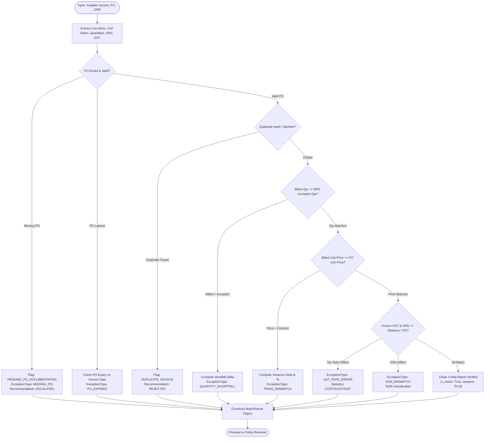
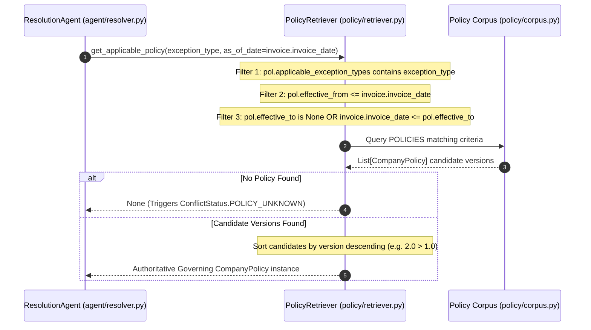
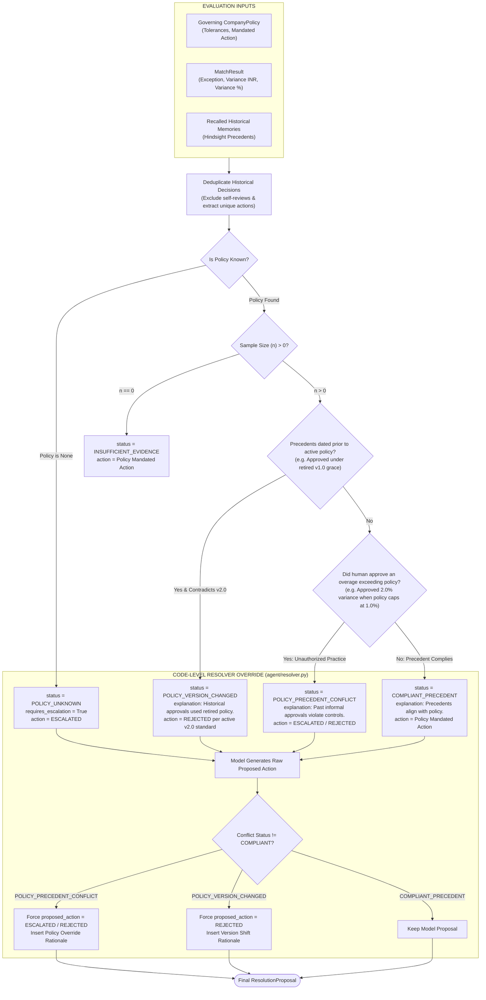
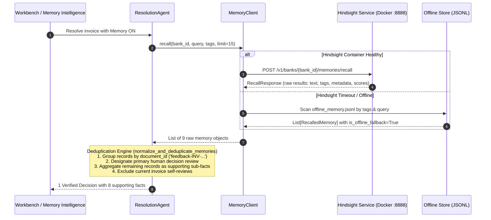
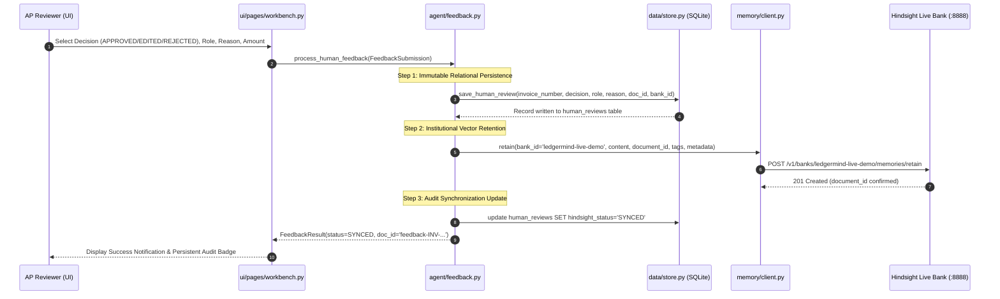

# LEDGERMIND — ARCHITECTURAL SPECIFICATIONS & MERMAID DIAGRAMS

**Document:** System Architecture, Data Flow, and Lifecycle Specifications  
**Status:** Verified Local Implementation  
**Auditor Roles:** Senior AI Systems Architect, RAG Engineer, QA Engineer  

---

## 1. Overall System Architecture

The current LedgerMind architecture combines a local relational database for financial audit integrity, a deterministic rule and policy engine for control enforcement, an isolated Docker container for Hindsight vector memory, and Groq cloud LLM for advisory explanations with local deterministic fallback.

```mermaid
flowchart TB
    subgraph UI_TIER["PRESENTATION TIER (Streamlit)"]
        Nav["app.py<br/>Multi-Page Navigation"]
        P1["Overview Dashboard<br/>(Metrics, Discrepancies)"]
        P2["Invoice Intake<br/>(Single & Batch Ingestion)"]
        P3["Exception Queue<br/>(Deep Inspector, Match Cards)"]
        P4["Resolution Workbench<br/>(Policy Cards, Memory, Actions)"]
        P5["Memory Intelligence<br/>(Vendor Profiles, Audit Telemetry)"]
        Nav --> P1
        Nav --> P2
        Nav --> P3
        Nav --> P4
        Nav --> P5
    end

    subgraph APP_TIER["APPLICATION & REASONING TIER"]
        Matcher["agent/matcher.py<br/>Deterministic 3-Way Match"]
        Retriever["policy/retriever.py<br/>Temporal Policy Retriever"]
        Corpus[("policy/corpus.py<br/>Versioned Company Policies")]
        Conflict["policy/conflict.py<br/>Policy-Precedent Conflict Detector"]
        Agent["agent/resolver.py<br/>ResolutionAgent"]
        Prompts["agent/prompts.py<br/>Structured Prompt Builder"]
        Confidence["agent/confidence.py<br/>Heuristic Confidence Scorer"]
        Feedback["agent/feedback.py<br/>Human Review Processor"]

        Retriever <--> Corpus
        Agent --> Matcher
        Agent --> Retriever
        Agent --> Conflict
        Agent --> Prompts
        Agent --> Confidence
        P4 --> Agent
        P4 --> Feedback
    end

    subgraph LLM_TIER["INFERENCE TIER"]
        Groq["agent/llm.py<br/>GroqClient (openai/gpt-oss-120b)"]
        FallbackEngine["agent/resolver.py<br/>Deterministic Fallback Engine"]
        Agent -->|Primary| Groq
        Agent -->|Offline / Rate-Limit| FallbackEngine
    end

    subgraph MEMORY_TIER["INSTITUTIONAL MEMORY TIER"]
        MemClient["memory/client.py<br/>MemoryClient (Async Lifecycle)"]
        MemOps["memory/operations.py<br/>Domain Memory Operations"]
        Budget["memory/budget_guard.py<br/>BudgetGuard (Cloud vs Local)"]
        ReflectCache["memory/reflect_cache.py<br/>Bank-Scoped Reflection Cache"]
        Hindsight[("Local Hindsight Container<br/>http://localhost:8888")]
        OfflineStore[("Offline JSONL Store<br/>offline_memory.jsonl")]

        Agent --> MemOps
        MemOps --> MemClient
        MemClient --> Budget
        MemClient --> ReflectCache
        MemClient <-->|Live Vector Search| Hindsight
        MemClient <-->|Offline Fallback| OfflineStore
    end

    subgraph STORAGE_TIER["PERSISTENCE & AUDIT TIER"]
        DBStore["data/store.py<br/>SQLite Storage Adapter"]
        SQLiteDB[("SQLite Database<br/>data/ledgermind.db")]
        DBStore <--> SQLiteDB
        P2 --> DBStore
        P3 --> DBStore
        Feedback --> DBStore
    end
```

---

## 2. Three-Way Matching & Discrepancy Detection Flow

Mathematical reconciliation compares supplier line-item billings against contracted commitments and physical warehouse receipts before any AI components are engaged.

---

## 3. Temporal Policy Retrieval & Version Selection

Corporate policies are dynamically selected by exception category and transaction date, ensuring expired guidelines cannot govern modern transactions.

---

## 4. Policy-Supremacy Conflict Handling Architecture

The core compliance safeguard prevents generative AI or historical precedents from violating financial controls.

---

## 5. Hindsight Memory Lifecycle & Deduplication Flow

LedgerMind resolves raw memory observations into logical human reviews to prevent artificial confidence inflation.

---

## 6. End-to-End Human Review & Audit Trail Flow

The closing loop guarantees that human decisions persist both in relational database tables for internal audit and in vector memory for institutional learning.

